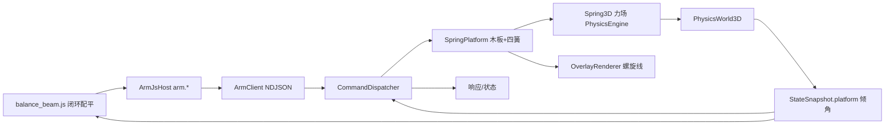

## 用户需求

在 `src\Controller\scripts` 中新增一个更复杂的 JS 演示脚本：地面上有一组弹簧，弹簧上托着一块正方形木板；木板上重量分布不均时，木板在不均匀重力与弹簧力的相互作用下发生倾斜，倾斜木板上的重物会在重力与摩擦力的相互作用下产生滑动；地面上另有 4 块重块，机械臂要依次拾取并放到木板上、不断调整位置，最终让木板保持平衡。

## 产品概述

这是一个"感知-决策-动作"闭环的综合演示：仿真侧提供真实的压簧-木板-重块动力学（弹簧力、重力矩、库仑摩擦、滑动），上位机侧用 JS 脚本读取木板倾角、决定下一块重块的落点、驱动机械臂完成抓取与放置，最后用微调轮次把倾角收敛到阈值内。整个过程通过现有的虚拟硬件协议（TCP/HTTP）与 LiteJs 宿主 API 完成。

## 核心功能

- 弹簧物理：木板四角各一根压簧支撑在地面上，可配置刚度、阻尼、自然长度；偏心负载时各簧压缩量不同，木板倾斜到力矩重新平衡为止。
- 木板与重物：木板是受弹簧支撑的动态刚体；重块放在木板上后随倾角滑动（重力分量大于静摩擦时滑落）。
- 机械臂配平：依次拾取地面上的 4 块重块放到木板，每放一块读一次倾角，按倾斜方向把下一块放到翘起的一侧，最后微调至平衡。
- 可视化：三维视口里把弹簧画成随压缩量实时伸缩的螺旋线。
- 状态反馈：协议状态里提供木板 id、X/Y 倾角、倾角幅值、各簧压缩量与弹力。


## 技术栈

- 语言与框架：VB.NET，`net10.0-windows`（VirtualWorkshop）与 `net10.0`（Controller），沿用现有工程与引用，不新增第三方依赖。
- 物理：`Microsoft.VisualBasic.Engine.Physics`（PhysicsEngine）：`PhysicsWorld3D`、`RigidBody3D`、`ForceField3D`、`BoxCollider3D`；**新增 3D 压簧**。
- 脚本：`LiteJs` 解释器 + `ArmJsHost` 宿主门面（注入 `arm` 全局对象）。
- 通信：现有 NDJSON over TCP / HTTP 协议，只新增指令与状态字段。

## 实现方案与关键决策

### 1. 为什么要在 PhysicsEngine 里新增 Spring3D

引擎的 `SpringJoint.vb` 是 **2D** 的，3D 侧只有 `BallJoint3D / HingeJoint3D / PrismaticJoint3D`（以及我们此前新增的 `RevoluteJoint3D / JointServo3D`）和 `ForceFields3D\{ForceField3D, GravityField3D}`，**没有任何 3D 弹簧**。按用户此前要求"缺失的仿真算法补进 PhysicsEngine 以便复用"，新增 `Spring3D`。

### 2. Spring3D 的形态：力场还是约束

- `PhysicsWorld3D.StepSub` 的顺序是：`重力 → ForceFields → 积分速度 → 宽相 → 窄相 → 迭代求解 → 积分位置`，力场在积分速度**之前**应用，弹簧力能正确进入积分。
- 采用 `Inherits ForceField3D` + 覆写 `Apply(bodies)`：实现简单、参数（k/c/restLength）语义直观、便于渲染与自检读取；显式力在高刚度下有发散风险，因此加 `MaxForce` 限幅，并给出"k/m 与子步 dt"的经验取值注释。
- 阻尼是必需的：无阻尼的压簧会永久振荡，木板无法稳定到一个倾角。

```vb
Namespace ForceFields3D
    ''' <summary>3D 压簧：世界锚点与刚体挂点之间的弹簧-阻尼器。</summary>
    Public Class Spring3D : Inherits ForceField3D
        Public Property Anchor As Vector3          ' 世界锚点（地面一侧）
        Public Property Body As RigidBody3D        ' 受作用的刚体（木板）
        Public Property LocalPoint As Vector3      ' 刚体局部挂点
        Public Property Stiffness As Double        ' N/m
        Public Property Damping As Double          ' N·s/m
        Public Property RestLength As Double
        Public Property MaxForce As Double         ' 限幅，防止显式力发散
        Public ReadOnly Property CurrentLength As Double
        Public ReadOnly Property Compression As Double   ' RestLength - CurrentLength
        Public ReadOnly Property CurrentForce As Double
        Public Overrides Sub Apply(bodies As IEnumerable(Of RigidBody3D))
    End Class
End Namespace
```

力的计算：`p = Body.Position + Body.Orientation.Rotate(LocalPoint)`；`delta = p - Anchor`；`dir = 归一化(delta)`；挂点速度 `v = Body.Velocity + AngularVelocity × (p - Body.Position)`；`F = (-k·(len - rest) - c·dot(v, dir))·dir`，限幅后用 `Body.ApplyForceAtPoint(p, F)`。

### 3. 木板为什么用四角弹簧

单个中心压簧只提供轴向力，不提供恢复力矩，偏心负载时木板会一直翻到掉下来。四角弹簧时各簧压缩量不同、簧力差形成恢复力矩，木板会倾斜到一个可平衡的姿态——这正是"挪动重块能改变倾角、可以配平"的物理基础。

### 4. 平台与指令

- 新增 `Simulation\SpringPlatform.vb`：木板（Box 刚体）+ N 根 `Spring3D`（默认 4 角），弹簧注册进 `world.ForceFields`；提供 `PlateBody`、`Springs`、`Tilt()`（相对世界 X/Y 轴的倾角，度）、`TiltMagnitude()`。
- 木板加入 `Simulation.Objects`（复用 `BlockInstance`），因此它自然出现在 `objects`（带 rotation，脚本可独立算倾角）、被渲染、可被 `clear`/`remove` 处理。
- 协议新增 `CmdPlatform = "platform"`：`{size, position, stiffness, damping, springs}`，返回 `{plateId, springs:[{index, length, compression, force}]}`；`state` 增加 `platform:{plateId, tiltX, tiltY, tiltMag, springs:[...]}`。
- `ArmSimulation` 持有 `Public Property Platform As SpringPlatform`，`Reset()/Clear` 时一并释放（从 `world.ForceFields` 移除）。

### 5. 弹簧的可视化

`OverlayRenderer` 新增 `ShowSprings` 与 `AddSprings(platform, anchor)`：用折线近似螺旋线圈（约 6 圈、每圈 8 段），圈高随 `Compression` 变化，颜色用 `UiTheme` 的 slate 灰阶（浅色主题）。走现有动态线通道（`EnsureLineCapacity` + `UploadLines`），不触发几何重建。注意 `PackColor()` 必须先 `CInt` 再移位（此前修过的 Byte 移位陷阱）。

### 6. 脚本的闭环策略

`scripts/balance_beam.js`：

1. `arm.clear()` → `arm.platform({size:[0.24,0.24,0.02], position:[0.36,0,0.09], springs:4})`
2. spawn 4 块重块（约 0.035 m、0.3 kg）摆在机械臂够得到的一排
3. 每轮：读 `arm.state().platform` 的 `tiltX/tiltY` → 目标落点 = 板心 + 往翘起侧偏移 `clamp(gain·倾角, ±半宽·0.8)` → `moveTo`（末端朝下 ry=90）下降 → `grip` → 抬起 → 移到落点 → 下降 → `release`
4. 四块放完后若 `tiltMag > 3°`：挑离板心最远的一块重新拾取并挪向翘起侧，最多若干轮
5. 每轮打印倾角、落点、是否 `BALANCED`

复用 `pick_and_place.js` 的成功经验：末端朝下（ry=90）、下降到"物体中心 z + 0.027"、`grip` 后等约 2.5 s（手指 25 mm/s）、抓取前先 `release()`、场景先 `clear()` 避免干扰。

### 7. 稳定性与可靠性

- 弹簧：刚度 2000~6000 N/m、阻尼 40~120 N·s/m、`MaxForce` 限幅；自检在 headless 下验证不发散。
- 木板摩擦系数调高（避免重块全部滑落），质量适中（约 0.6 kg），静止高度约 0.09 m（机械臂可达且在地面网格之上）。
- 平台是普通动态物体，不参与机械臂的地面穿透检测（`GroundViolation` 只查机械臂连杆）。
- 自检新增"弹簧平台"段：无负载时四簧压缩量相等；加偏心重块后出现倾角且方向正确；移除后回弹；全程不发散（位置/力有限）。

## 架构设计



## 目录结构

```
G:\GCModeller\src\runtime\sciBASIC#\physics\Engine\
└── ForceFields3D\
    └── Spring3D.vb                          # [NEW] 可复用的 3D 压簧（力场）：k/c/restLength/MaxForce，暴露 CurrentLength/Compression/CurrentForce

G:\virtual-lab\src\VirtualWorkshop\
├── Simulation\
│   ├── SpringPlatform.vb                    # [NEW] 木板 + 四角弹簧组合体；Tilt/TiltMagnitude；弹簧列表供渲染与状态使用
│   ├── ArmSimulation.vb                     # [MODIFY] 新增 Platform 属性与 BuildPlatform(...)，Reset/Clear 时释放弹簧力场
│   └── StateSnapshot.vb                     # [MODIFY] 新增 PlatformState{PlateId,TiltX,TiltY,TiltMagnitude,Springs[]} 并挂到 StateSnapshot
├── Protocol\
│   ├── ProtocolText.vb                     # [MODIFY] 新增 CmdPlatform="platform" 与相关字段常量
│   └── CommandDispatcher.vb                 # [MODIFY] 新增 Platform(args)：创建/查询/移除弹簧平台
├── Rendering\
│   └── OverlayRenderer.vb                   # [MODIFY] 新增 ShowSprings 与 AddSprings（螺旋线，随压缩量伸缩）
└── Diagnostics\
    └── SimSelfTest.vb                       # [MODIFY] 新增"弹簧平台"断言段

G:\virtual-lab\src\Controller\
├── Scripting\
│   └── ArmJsHost.vb                         # [MODIFY] 新增 platform(options) 与 tilt() 便捷读取
└── scripts\
    └── balance_beam.js                      # [NEW] 弹簧木板配平演示：依次放 4 块重块 + 倾角反馈闭环微调
```

## 关键契约

平台指令：

```
{"id":1,"cmd":"platform","params":{"size":[0.24,0.24,0.02],"position":[0.36,0,0.09],
                                    "stiffness":4000,"damping":80,"springs":4}}
→ {"ok":true,"result":{"plateId":"block-13","size":[0.24,0.24,0.02],
                       "springs":[{"index":0,"length":0.062,"compression":0.018,"force":72.0}, ...]}}
```

状态字段：

```
"platform": {"plateId":"block-13","tiltX":-2.4,"tiltY":1.1,"tiltMag":2.64,
             "springs":[{"compression":0.018,"force":72.0}, ...]}
```

倾斜判据：`tiltX` 为绕世界 X 轴的倾角、`tiltY` 为绕世界 Y 轴的倾角（度），`tiltMag = sqrt(tiltX² + tiltY²)`；脚本把重块放到"翘起侧"（倾角符号相反的一侧）来抵消力矩。


## Agent Extensions

### SubAgent

- **code-explorer**
- Purpose: 实现前逐字核对底层签名，避免凭记忆写错：`ForceField3D.Apply(bodies)` 的覆写签名、`RigidBody3D.ApplyForceAtPoint(worldPoint, f)` 与 `Orientation.Rotate(v)` 的确切形式、`Vector3` 的叉积/点积辅助（`Vector3Math.Cross/Dot`）、`PhysicsWorld3D.Add(ForceField3D)` 重载、`BlockInstance` 的字段构成、以及 `OverlayRenderer.AddLine` 的缓冲格式。
- Expected outcome: 给出带文件行号的逐字签名，使 `Spring3D`、`SpringPlatform`、协议与渲染代码一次编译通过。
