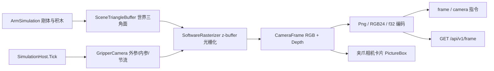

## 用户需求

为虚拟六轴机械臂的夹爪增加一个第一视角摄像头：在工作台窗口（`src\VirtualWorkshop\VirtualWorkshop.vbproj`）里实时显示"从夹爪看出去"的画面，并对外提供 API 输出拍摄到的图像帧数据，供神经网络训练与调试使用。

## 产品概述

摄像头安装在机械臂末端（link6）上，随手腕姿态实时改变视角：零位时朝前看，末端转成朝下时正好俯视桌面上的积木与夹持点。画面由仿真场景实时渲染生成（不是截图三维视口），因此无界面加速模式下同样能取到帧。上位机可通过 TCP 指令或 HTTP 直接取图，并能拿到与像素对齐的深度数据用于三维反投影。

## 核心功能

- 夹爪相机：针孔相机模型，安装位置/朝向、分辨率、视场角、帧率均可配置，默认 320×240 @ 15 Hz。
- 实时画面：工作台右侧新增"夹爪相机"卡片，显示当前第一视角画面，并给出分辨率、帧率、单帧耗时与相机位姿读数。
- 帧数据 API：
- PNG 编码（base64），适合存盘、回放与可视化；HTTP 可直接返回 image/png。
- 原始 RGB24（`width*height*3` 字节，base64），神经网络可直接 reshape 成张量。
- 深度图（float32 米，另提供 u16 毫米），与 RGB 像素一一对应，用于点云反投影与遮挡判断。
- 相机参数查询与在线调整（分辨率、FOV、开关、安装偏移），并提供内参 fx/fy/cx/cy 与当前外参，便于坐标系换算。
- 上位机支持：REPL 增加 `frame` 命令（把帧写盘并打印信息）；JS 脚本可拿到帧数据并保存文件。
- 无界面模式（headless）与自检同样可用；可用参数彻底关闭相机以节省 CPU。

## 技术栈选择

- 语言与框架：VB.NET，`net10.0-windows`（沿用现有 `VirtualWorkshop.vbproj`，WinForms + `UseWPF`），不新增工程、不新增第三方依赖。
- 渲染：**纯托管 CPU 软件光栅化**（三角形光栅化 + z-buffer + Lambert 光照），新增代码全部在 `VirtualWorkshop\Sensing\` 下。
- 编码与显示：`System.Drawing.Bitmap`（PNG 编码、PictureBox 显示），`System.Drawing.Common` 已随 `UseWindowsForms` 可用。
- 序列化：继续用 `System.Text.Json`（`JsonObject`），帧像素以 base64 字符串承载。
- 协议：沿用现有 NDJSON over TCP + 手写 HTTP/1.1，只新增指令与端点，不改既有语义。

## 实现方案与关键决策

### 1. 为什么不用 Direct3D 离屏渲染（关键决策）

- `DxScene3DCanvas` 只能渲染它自己的视口相机，`SaveSnapshot` 截取的是整个视口，无法指定"夹爪相机"的位姿与投影矩阵；
- headless 模式完全没有渲染上下文与窗口，D3D 方案直接不可用；
- 用户要求"神经网络训练用的帧数据"，需要确定性、可复现、可离线批量取图。

因此采用**纯托管 CPU 光栅化**：GUI 与 headless 共用同一份代码，帧内容只取决于仿真状态与相机参数，完全确定可复现。

### 2. 相机模型与安装

- 挂在 `link6` 刚体上：`world = body.Position + R·(localOffset)`，朝向直接取 `link6` 的旋转（`forward = link6 +X`，`up = link6 +Z`），默认偏移 `(0.045, 0, 0)`，落在两指之间、手腕前方。
- 针孔投影：`fx = fy = (H/2) / tan(fov/2)`，`cx = W/2`，`cy = H/2`；视场角默认 60°（水平方向按宽高比换算，保证不拉伸）。
- 因为 glb 中确实存在 `Camera` 节点（相对 link6 偏移 0.03, 0.034, 0），但它没有对应的 URDF link，所以相机外参一律由代码从 link6 刚体位姿构造，不依赖 URDF。

### 3. 光栅化实现

- 逐三角形：世界坐标 → 相机视图（`R^T·(p - camPos)`）→ 近平面裁剪（near=0.02 m）→ 透视投影 → 屏幕空间有向面积判断朝向 → 扫描线填充 + 1/z 深度插值写 z-buffer。
- 着色：`color = material * (ambient + diffuse * max(0, dot(n, L)))`，单方向光（与视口光照方向一致），环境光 0.35，保证背光面不至于全黑。
- 双面渲染（与视口 `CullBackFaces = False` 一致），避免夹爪内侧看穿模型。
- 缓冲复用：`Byte()` RGB 与 `Single()` 深度缓冲按分辨率缓存，仅在分辨率变化时重建；每帧只新建一个 `CameraFrame` 对象发布出去。

### 4. 帧生成时机与线程模型

- 帧**只在仿真线程生成**：`SimulationHost.Tick` / `StepFixed` 在 `Me.State = ...` 之后调用 `Camera.MaybeCapture(Simulation)`，按 15 Hz 间隔节流（GUI 的 tick 在 UI 线程，headless 在仿真循环线程，二者都是"仿真线程"，无并发写）。
- `frame` 指令走现有 `Host.Post` → 队列 → 仿真线程执行，内部调用 `CaptureNow` 立即渲染（不受节流限制），因此拿到的帧与返回的 `time/step` 严格一致。
- GUI 线程只读 `Camera.Latest`（`Volatile` 引用），不做任何物理/几何遍历；`PictureBox` 每帧替换 `Image` 并 `Dispose` 旧图，避免 GDI 句柄泄漏。

### 5. 性能与可靠性

- 320×240、2704 三角形：实测预期 2~5 ms/帧；15 Hz 下 CPU 占用约 3~8%，对 120 Hz 仿真步进无感。
- 深度缓冲使用 `Single`（米），背景写 `0`；RGB 背景色与三维视口一致（`#0B0F14`），便于视觉对照。
- 相机异常（NaN、除零、缓冲越界）被捕获后置 `Faulted` 状态并保留上一帧，绝不让它中断仿真 tick。
- 提供 `--camera off` 与 `config {key:"camera_enabled"}` 两条关闭路径。
- 协议向后兼容：`state` 只增加轻量 `camera` 摘要（无像素），既有字段与指令语义完全不变。

## 架构设计



### 数据流

仿真步进 → 相机位姿解析（link6 位姿 × 安装偏移）→ 世界三角面变换 → 光栅化 → RGB/深度缓冲 → 发布 `Latest` → 三路消费（UI 显示、TCP `frame`、HTTP `/api/v1/frame`）。

## 目录结构

```
src/VirtualWorkshop/
├── Sensing/                                   # 新增：第一视角相机
│   ├── CameraConfig.vb                        # [NEW] 相机配置：分辨率、FOV、帧率、安装偏移、开关；提供内参计算与命令行/JSON 互转
│   ├── CameraPose.vb                          # [NEW] 相机外参：位置 + 旋转 + 前向/上向；由 link6 刚体位姿与局部偏移构造；输出 rpy 与四元数
│   ├── SceneTriangleBuffer.vb                 # [NEW] 把仿真世界（机械臂各连杆、手指、积木）转成"世界坐标三角面 + 颜色"扁平数组；复用 SceneBuilder 的变换公式但不减渲染锚点
│   ├── SoftwareRasterizer.vb                  # [NEW] 纯托管光栅化：视图变换、近裁剪、透视投影、扫描线填充、z-buffer、Lambert 着色；缓冲复用
│   ├── CameraFrame.vb                         # [NEW] 一帧数据：宽高、RGB24、深度 float32、时间/步数、外参；提供 ToBitmap/ToPng/ToPngBase64/RgbBase64/DepthF32Base64/DepthU16MmBase64
│   └── GripperCamera.vb                       # [NEW] 相机门面：MaybeCapture 节流、CaptureNow 强制渲染、Latest 发布、FPS/耗时统计、Describe() 生成状态摘要、异常隔离
├── Simulation/
│   ├── SimulationHost.vb                      # [MODIFY] 新增 Camera 属性；Tick/StepFixed 末尾调用 MaybeCapture；发布 State 时填充 Camera 摘要
│   ├── StateSnapshot.vb                       # [MODIFY] 新增 CameraState{Enabled,Width,Height,Fov,Fx,Fy,Position,Pitch,Yaw,Fps,LastMs} 与 StateSnapshot.Camera
│   └── SimulationPreset.vb                    # [MODIFY] 用命令行选项构造 CameraConfig 并交给 SimulationHost
├── Protocol/
│   ├── ProtocolText.vb                        # [MODIFY] 新增 CmdFrame="frame"、CmdCamera="camera"，字段 Width/Height/Format/Depth/Camera/Pose/Fx/Fy/Cx/Cy
│   ├── CommandDispatcher.vb                   # [MODIFY] 新增 Frame(args) 与 Camera(args)：参数校验、按需即时渲染、三种编码、返回内参外参
│   └── HttpServer.vb                          # [MODIFY] 新增 GET /api/v1/frame（返回 image/png）与 GET /api/v1/frame.json；新增 WriteBytes 二进制响应，Content-Type 可配置
├── Configuration/
│   └── SimulationOptions.vb                   # [MODIFY] 新增 --camera on|off、--camera-size WxH、--camera-fov、--camera-rate、--camera-offset x,y,z
├── Diagnostics/
│   └── SimSelfTest.vb                         # [MODIFY] 新增相机断言：帧尺寸、非全黑、深度范围、PNG 魔数、深度字节数、state.camera 摘要
├── FormVirtualLab.Designer.vb                 # [MODIFY] 在 gripCard 与 objectCard 之间插入 cameraCard（高 236），内含 m_picCamera（359×200, SizeMode=Zoom）与 m_lblCamera；调整 Controls.Add 顺序保证卡片自上而下排列
├── FormVirtualLab.vb                          # [MODIFY] 新增 UpdateCameraPanel（读取 Host.Camera.Latest，替换并释放旧 Bitmap，刷新读数标签）；窗体关闭时释放
└── Program.vb                                 # [MODIFY] 帮助文本补充相机参数；--inspect 打印相机默认内参

src/Controller/
├── Program.vb                                 # [MODIFY] REPL 新增 frame [png|rgb|depth] [输出路径] 命令：取帧、写盘、打印分辨率/字节数/耗时
└── Scripting/ArmJsHost.vb                     # [MODIFY] 新增 frame(options) 返回字典、saveFrame(path) 写 PNG，供 JS 脚本采集画面
```

## 关键契约

帧查询指令（TCP NDJSON，HTTP body 同构）：

```
请求: {"id":9,"cmd":"frame","params":{"format":"png","depth":"f32","width":320,"height":240}}
响应: {"id":9,"ok":true,"result":{
        "width":320,"height":240,"time":3.42,"step":410,
        "format":"png","data":"<base64 png>",
        "depth":{"format":"f32","data":"<base64 320*240*4 字节，小端 float32 米>"},
        "camera":{"position":[0.31,-0.02,0.18],"rpy":[0,90,0],"fov":60,
                  "fx":277.1,"fy":277.1,"cx":160,"cy":120}}}
```

`format` 取值：`png`（默认）/`rgb`（`w*h*3` 裸字节 base64）/`both`/`all`；`depth` 取值：省略或 `false` /`f32`/`u16mm`。

相机参数指令：

```
{"cmd":"camera","params":{"width":320,"height":240,"fov":60,"enabled":true,"rate":15,"offset":[0.045,0,0]}}
→ {"ok":true,"camera":{...同上...}}
```

HTTP：`GET /api/v1/frame` 直接返回 `image/png`；`GET /api/v1/frame.json?depth=f32` 返回上面的 JSON。

核心类型（各模块共享的契约）：

```
Public Class CameraFrame
    Public Property Width As Integer
    Public Property Height As Integer
    Public Property Rgb As Byte()          ' Width*Height*3
    Public Property Depth As Single()      ' Width*Height，米，0 表示背景
    Public Property Time As Double
    Public Property StepIndex As Long
    Public Property Pose As CameraPose
    Public Function ToBitmap() As Bitmap
    Public Function ToPng() As Byte()
End Class
```

## 执行要点

- 现有 `SceneBuilder.BuildSurfaces` 输出的是**已减去渲染锚点**的坐标，相机渲染必须用未减锚点的世界坐标，不要复用它的返回值（复用变换公式即可）。
- `MeshTriangle` 顶点是 URDF link 局部坐标，刚体原点是惯量原点：`world = body.Position + R·(p - InertialOriginOf(link))`；手指与积木的网格顶点已相对自身质心（origin 取 `Vector3.Zero`）。
- `Drawing3D.Surface.brush` 用的是 `Microsoft.VisualBasic.Imaging.Brush`，而 PictureBox/PNG 用 `System.Drawing.Brush/Bitmap`，两者同名不同程序集，不要互相赋值。
- `UiTheme.CreateCard(title)` 返回 `Panel` 且标题占顶部，卡片内容控件需 `Dock = Fill` 或显式坐标；新增卡片后要按 `objectCard → cameraCard → gripCard → tcpCard → jointCard` 的顺序 `Controls.Add`，才能保证自上而下的停靠次序。
- VB 陷阱：Module 内成员不能加 `Shared`；局部变量不能与类型名/属性名同名；`System.Math.xxx` 全限定；`System.IO.Path`/`System.Environment` 全限定。
- 帧的 base64 单行可达数百 KB（PNG 约 10~40 KB，RGB 约 300 KB），`TcpServer` 用 `ReadLine` 无长度限制，但要避免在状态订阅里推送像素。
- 自检必须在 headless 下跑通（不依赖任何窗口/GPU），断言失败要能被 `SELFTEST PASS/FAILURES` 统计到。

### SubAgent

- **code-explorer**
- Purpose: 在实现前核对底层 API 的精确签名，避免凭记忆写错：`Quaternion.Rotate` / `Vector3` 的字段与运算、`RigidBody3D.Position/Orientation`、`ArmAssembly.InertialOriginOf`、`UiTheme.CreateCard` 与 `FontMonoSmall`、`JsonText` 的取值辅助方法（Str/Int/Bool/ObjectOf）、`HttpServer.WriteResponse` 的调用点。
- Expected outcome: 给出逐字签名与文件行号，使相机内核与协议代码一次编译通过。