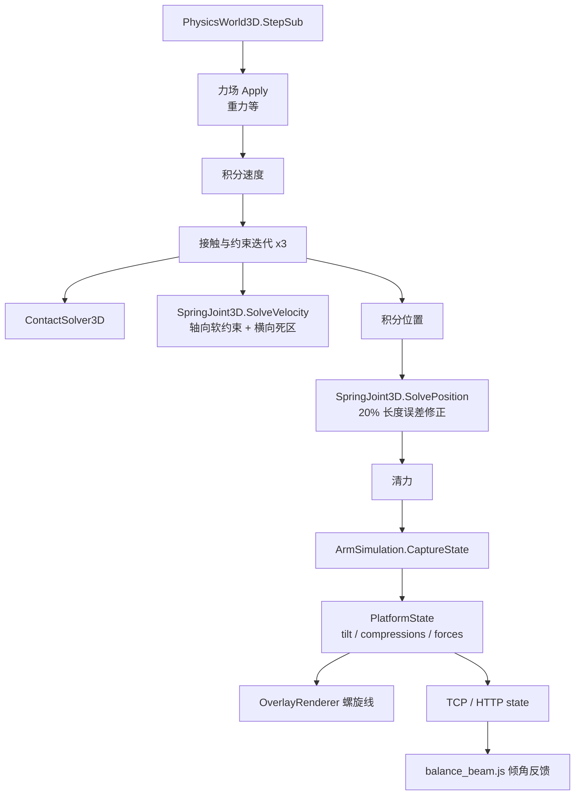

## 产品概述
把弹簧平台从"每帧施加一个力"改为"真正的弹簧连接"。弹簧两端分别固定在**地面锚点**与**木板底面四角**，双向受力（可压可拉），并同时提供**轴向刚度**与**横向（剪切）刚度**。目标是让木板既不会因为冲击被压到行程限位，也不会横向漂移，同时保留肉眼可见的倾斜；使"搬运四块重块、读倾角、把木板配平"的演示能够稳定跑完。

## 核心功能
- 弹簧成为"连接件"：两端严格跟随各自的锚点，木板被抬起时弹簧拉回、被压低时推开，不再出现"脱离弹簧"或"只靠穿透深度支撑"的现象
- 弹簧同时具备轴向刚度与横向剪切刚度；横向允许 1 mm 的微量错位不产生力（死区），超过后按轴向刚度的一半拉回
- 木板受偏心负载时四角弹簧压缩量不同、木板产生 2 至 3 度的倾斜；负载移除后能平滑回弹到水平
- 木板在受到碰撞后不会横向漂走；即使把阻尼参数调得很大也不会发散
- 三维视口里弹簧上下两端都贴合地面与板底，随压缩量实时伸缩
- 状态与协议继续输出每根弹簧的压缩量、弹力、长度与自然长度，供脚本判断与配平
- 机械臂演示脚本能完整跑通：依次拾取四块重块放到木板四象限，按倾角反馈调整，最终倾角收敛


## 技术栈
- 物理引擎：`G:\GCModeller\src\runtime\sciBASIC#\physics\Engine`（VB.NET，既有 `PhysicsWorld3D` / `RigidBody3D` / `IConstraint3D`）
- 仿真工作台：`G:\virtual-lab\src\VirtualWorkshop`（VB.NET，x64）
- 上位机与脚本：`G:\virtual-lab\src\Controller`（LiteJs）
- 渲染：`DxScene3DCanvas` 表面几何 + `OverlayRenderer` 动态线通道

## 实现思路

### 1) 为什么必须改成"约束"而不是继续调"力"
现有 `ForceFields3D\Spring3D.vb` 是**显式力**：每子步在积分速度前调用 `ApplyForceAtPoint`。这会带来三个无法通过调参解决的病态：
- 刚度或阻尼一大就发散（实测 `damping=300` 木板飞到 6 m，`damping=100` 抬块后冲过平衡点 2.3 cm）
- 支撑力只能靠穿透深度表达，参数对 `Slop`、`MaxForce`、`ShearStiffness` 极度敏感
- 横向刚度与倾斜互相打架：`4k` 时倾斜被压掉 4 至 20 倍，`1k` 才恢复但抑制漂移不足

因此新增 `Joints3D\SpringJoint3D.vb`，实现 `IConstraint3D`，在**速度层用柔度（compliance）求解冲量**。引擎每个子步对 `Constraints` 做 3 轮 `SolveVelocity`，随后 `SolvePosition` 做温和位置修正，这正好是软约束该待的位置；大刚度也能稳定。

### 2) 轴向软约束（Box2D distance joint 形式）
```
pA, pB   : 两端世界坐标（A 为 Nothing 时 pA 就是世界锚点）
d = pB - pA ; len = |d| ; n = d/len ; C = len - RestLength
Cdot     : (vB + ωB×rB - vA - ωA×rA)·n
gamma    = 1 / (dt·(Damping + dt·Stiffness))
bias     = C · dt · Stiffness · gamma
m_eff    = 1 / (invMassA + invMassB + n·(IA⁻¹(rA×n)×rA) + n·(IB⁻¹(rB×n)×rB) + gamma)
lambda   = -m_eff · (Cdot + bias)      // 按 MaxForce·dt 限幅
B 施加 +lambda·n，A 施加 -lambda·n（A 为 Nothing 时只给 B）
```
`Bidirectional=False` 时仅在 `C 小于 0`（压缩）才施力；本方案默认 `True`（用户已确认双向）。

### 3) 横向剪切（含死区）
```
lateral = d - n·(d·n) ; t1,t2 为 n 的正交基
每个方向：C_t = lateral·t 先做死区处理（|C_t| 小于等于 ShearSlop 时视为 0，否则扣掉 ShearSlop 保号）
参数用 ShearStiffness / ShearDamping，同样的 gamma/bias/m_eff/lambda 形式
默认 ShearStiffness = 0.5 × Stiffness、ShearSlop = 1 mm
```
横向约束目标是"挂点回到锚点所在轴线"，但因为有死区且刚度只有一半，倾斜只被削弱约一半而不是锁死，正好落在 2 至 3 度。

### 4) 位置层修正
`SolvePosition` 只按长度误差的 20% 沿 `n` 平移两端（按质量比分配），不做"传送式"直改，避免抖动；横向不做位置修正（交由速度层与死区）。

### 5) 平台接线
`SpringPlatform` 的四角弹簧从 `Spring3D` 换成 `SpringJoint3D`：
- `A = Nothing`、`AnchorA = 地面锚点世界坐标`
- `B = plate`、`AnchorB = 板底角点（局部坐标）`
- `RestLength = 板底离地高度`、`Stiffness/Damping` 来自指令参数、`ShearStiffness = k×0.5`
- 通过 `world.Add(joint)` 进入 `Constraints`（不是 `ForceFields`）
- 删除已无用的 `CenterShear`；保留挡块作为极端过载的硬限位，保留 `PlateMesh/StopperMesh`

### 6) 渲染与状态
- `OverlayRenderer.AddSprings` 改用 `joint.WorldAnchorA / joint.WorldAnchorB` 画螺旋，两端严格贴合地面与板底
- `SpringPlatform.Compressions()/Forces()` 读 `joint.Compression / joint.CurrentForce`
- `platform` 指令返回的 `springs[]` 保持 `compression/force/length/rest` 字段，把无意义的 `applyCount` 换成 `stiffness`

## 架构设计


## 目录结构

```
G:\GCModeller\src\runtime\sciBASIC#\physics\Engine\
└── Joints3D\
    └── SpringJoint3D.vb            # [NEW] 约束式弹簧关节

G:\virtual-lab\src\VirtualWorkshop\
├── Simulation\
│   └── SpringPlatform.vb           # [MODIFY] 四角改用 SpringJoint3D，删除 CenterShear，Springs 类型改为 List(Of SpringJoint3D)
├── Rendering\
│   └── OverlayRenderer.vb          # [MODIFY] AddSprings 改用 WorldAnchorA/WorldAnchorB
├── Protocol\
│   └── CommandDispatcher.vb        # [MODIFY] springs[] 去掉 applyCount，改输出 stiffness
└── Diagnostics\
    └── SimSelfTest.vb              # [MODIFY] 新增弹簧平台验收断言

G:\virtual-lab\src\Controller\
└── scripts\
    └── balance_beam.js             # [MODIFY] 按新弹簧特性重调参数并跑通全流程
```

**`Joints3D\SpringJoint3D.vb`**（新建，属 PhysicsEngine，可复用）
- 目的：提供可在任意两个刚体（或刚体与世界锚点）之间工作的双向弹性连接
- 功能：`A/AnchorA/B/AnchorB/RestLength/Stiffness/Damping/ShearStiffness/ShearDamping/ShearSlop/Bidirectional/MaxForce/Label`；只读 `WorldAnchorA/WorldAnchorB/CurrentLength/Compression/CurrentForce/Direction`
- 实现要求：
  - `SolveVelocity(dt)` 按上文柔度公式分别解轴向与两个横向方向；`A` 为 `Nothing` 时把 `invMassA`、`rA` 短路为 0，只对 B 施加冲量
  - 冲量施加用 `ApplyImpulse(impulse, contactVector)`，`contactVector = rA/rB`
  - `MaxForce` 兜底：`|lambda|` 不超过 `MaxForce·dt`
  - `SolvePosition(dt)` 只做 20% 长度误差修正，横向不修正
  - 注释里写清"为什么不能用力场、柔度公式推导、dt 量纲、死区含义"

**`Simulation\SpringPlatform.vb`**（改造）
- 目的：木板与地面之间的四根弹簧改为真正的约束
- 功能：`Springs` 类型改为 `List(Of SpringJoint3D)`；`Create` 里构造四个 `SpringJoint3D` 并 `world.Add`；`Detach` 从 `world.Constraints` 移除（同时保留挡块与网格的移除）
- 实现要求：删除 `CenterShear` 相关字段、创建与移除逻辑；`RestLength` 仍取 `center.z - thickness/2`；`ShearStiffness = Stiffness×0.5`、`ShearDamping = Damping`、`ShearSlop = 0.001`、`Bidirectional = True`；`MaxForce` 作为兜底（如 1500）

**`Rendering\OverlayRenderer.vb`**（改造）
- 目的：弹簧螺旋线两端严格贴合
- 功能：`AddSprings` 与 `AddSpringCoil` 的入参类型改为 `SpringJoint3D`，端点用 `WorldAnchorA/WorldAnchorB`
- 实现要求：把从 `Spring3D` 取 `Anchor/AttachPoint` 的地方替换掉；螺旋圈数与半径逻辑保持不变；`TryCast` 兜底可去掉

**`Protocol\CommandDispatcher.vb`**（微调）
- 目的：状态字段与新实现一致
- 功能：`PlatformInfo` 里 `springs[]` 去掉 `applyCount`，改为 `stiffness`；`compression/force/length/rest` 保持不变
- 实现要求：`length` 取 `joint.CurrentLength`，`rest` 取 `platform.RestLength`，不改变既有字段名以免破坏脚本

**`Diagnostics\SimSelfTest.vb`**（新增断言）
- 目的：把本轮的物理指标变成可回归检查
- 功能：新增"弹簧平台"段，用 `platform` 指令建板，按顺序验证：空载倾角小于 0.3 度且四簧压缩差小于 0.5 mm、单块 0.6 kg 偏心倾角在 2 至 4 度且压缩差大于 8 mm、四块四象限后板高大于 0.09 m、移除后 2 秒回弹、加载卸载后板心水平漂移小于 5 mm、`damping` 调到 300 不发散（位置小于 1 m）
- 实现要求：断言用 `host.ExecuteNow(ProtocolText.CmdPlatform, ...)` 与 `host.StepFixed(n)`；读 `host.State.Platform`；每一项都给中文标题，失败时打印实测值

**`scripts\balance_beam.js`**（参数与流程微调）
- 目的：让演示稳定收敛
- 功能：板 0.30×0.30×0.03 位于 (0.36, 0, 0.12)、`stiffness` 200、`damping` 60、重块 0.6 kg、四象限偏移 ±0.07；保留高位平移 0.40 与 `descendSlowly` 分段下降、`place` 释放高度 `top + FINGER_DROP + 0.005`
- 实现要求：若新弹簧下板不再下沉，`place` 与 `pick` 的高度常量按实测重算；`BALANCED` 判据保持倾角阈值 3 度；脚本结束时打印四簧压缩量与最终倾角

## 性能与可靠性
- 每子步新增 4 次软约束求解（每约束 3 轮迭代），开销可忽略；`SpringJoint3D` 内部不分配对象，避免 GC 抖动
- 柔度公式在 `Damping=0` 时 `gamma = 1/(dt²·Stiffness)` 仍有限，不会除零；`Stiffness=0` 时退化为纯阻尼
- 世界锚点分支短路 `invMassA`，不会产生除零或 NaN
- 只新增引擎文件并改四个调用点，`Spring3D.vb` 保留不动（向后兼容），不影响既有协议语义与界面布局

## 风险与对策
- **倾斜被横向刚度锁死**：横向取 0.5×轴向并加 1 mm 死区；若实测仍偏小，把 `ShearStiffness` 降到 0.3×轴向
- **板被压到挡块**：软约束下支撑力不再依赖穿透，预期不再下沉；若仍触底则是 `Stiffness` 相对负载过小，按验收第 3 条调参
- **约束 3 轮迭代导致冲量重复累加**：`lambda` 每轮从头计算（不做跨轮 warm starting），并在注释中说明
- **VB 陷阱**：Module 成员不能加 `Shared`；`Byte` 移位会溢出；局部变量不能与属性或类型同名；`System.Math` 全限定


## Agent Extensions
### SubAgent
- **code-explorer**
  - Purpose: 在动手写 `SpringJoint3D` 前，核对 `RigidBody3D` 与 `Matrix3x3` 的确切成员（`InvInertiaWorld`、`ApplyImpulse`、`Quaternion.Rotate`）、`BallJoint3D`/`RevoluteJoint3D` 里可复用的有效质量与限幅辅助函数，以及 `PhysicsWorld3D.Constraints` 的添加与移除方式，避免凭记忆写错签名
  - Expected outcome: 一份可直接落笔的接口清单（成员名、参数、返回类型），以及一处可参照的约束式实现样板
