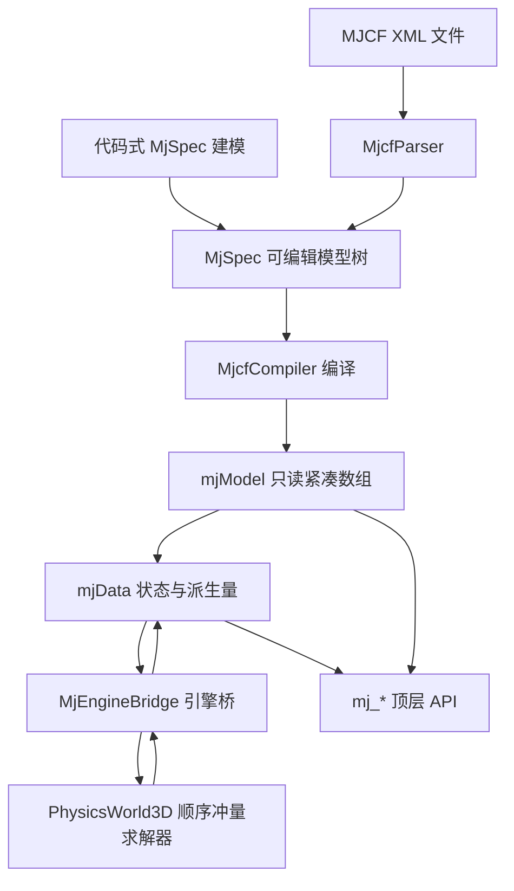

## 用户需求

在 `G:\virtual-lab\src\MuJoCo\MuJoCo.vbproj` 中，模仿 `C:\Users\Administrator\Downloads\mujoco-main`（MuJoCo 3.17 开发版）的源码组织与 API 形状，以 `G:\GCModeller\src\runtime\sciBASIC#\physics\Engine\PhysicsEngine.vbproj` 作为后端计算内核，封装出一套**纯托管**（不 P/Invoke 原生 mujoco.dll）的仿真算法库；再用这套库替换 `G:\virtual-lab\src\MicroduckLab\MicroduckLab.vbproj` 中现有的手写仿真代码。

## 功能内容

**1. MuJoCo 风格托管仿真库**

- 可编辑的模型树（等价 `mjSpec`/`mjsBody`/`mjsGeom`/`mjsJoint`/`mjsActuator`），可在运行时用代码拼装场景，也可从 MJCF 的 XML 文件编译成模型。
- 编译后的只读模型（等价 `mjModel`）：按 MuJoCo 的紧凑数组布局保存 body 树、关节、自由度、几何体、站点、网格、材质、执行器、传感器、等式约束、腱、关键帧，以及选项与统计量。
- 仿真状态（等价 `mjData`）：广义坐标 `qpos`、广义速度 `qvel`、控制量 `ctrl`、加速度 `qacc`、世界位姿 `xpos`/`xquat`/`xmat`、几何体与站点世界位姿、质心与惯性、质量矩阵、偏置力、接触列表、传感器数据、能量。
- 推进仿真：`mj_step`、可分离的 `mj_step1`/`mj_step2`、只刷新派生量不积分的 `mj_forward`、逆动力学 `mj_inverse`、重置 `mj_resetData`/`mj_resetDataKeyframe`。
- 动力学与运动学工具：前向运动学 `mj_kinematics`、`mj_comPos`、`mj_comVel`、雅可比 `mj_jac`/`mj_jacBody`/`mj_jacBodyCom`/`mj_jacSite`/`mj_jacGeom`/`mj_jacPointAxis`/`mj_jacDot`、`mj_fullM`/`mj_mulM`、状态打包 `mj_stateSize`/`mj_getState`/`mj_setState`、射线 `mj_ray`。
- 名称与对象寻址：`mj_name2id`/`mj_id2name` 覆盖 body/joint/dof/geom/site/camera/light/mesh/material/actuator/sensor/key 等对象类型。
- 关节类型：自由（7 坐标/6 速度）、球（4/3）、滑动（1/1）、铰链（1/1），以及无关节的焊接连接。
- 执行器类型：位置伺服、力矩马达、速度伺服，含增益、偏置、控制范围与力范围。
- 场景物体：无限地面、箱体、球体、胶囊、圆柱、椭球、网格（STL）都能作为几何体进入模型；小球以自由关节 + 完整接触维度参与仿真。

**2. MicroduckLab 迁移**

- 删除手写的刚体树装配、PD 伺服钩子与伺服约束死代码，改为直接持有编译后的模型与仿真状态，控制量直接写入 `ctrl`，每控制周期推进 4 个 5 毫秒子步。
- 场地（地面、四面矮墙、可选矮丘）与可踢小球改为用模型树 API 在运行时构建。
- 观测（61 维）改从状态量与传感器（陀螺、姿态四元数）读取；渲染仍通过既有快照结构取位姿，画面、操作、音频、UI 行为保持不变。
- 移除项目对物理引擎项目的直接引用。

**3. 自测与报告**

- 新增控制台自测项目，覆盖 MJCF 加载、维度与索引一致性、自由落体、单摆、雅可比/质量矩阵、状态打包往返、鸭子模型长时间站立稳定性，并生成测试报告。

## 视觉与运行效果

无新增界面。MicroduckLab 的 3D 画面、HUD、菜单、音频与交互完全保持现状：鸭子仍以同样的模型与配色渲染，仍是 50 Hz 控制、按策略行走/翻滚/踢球/坐站，画面无回归。

## 1. 技术栈

| 项 | 选择 | 说明 |
| --- | --- | --- |
| 语言 | VB.NET（`Option Strict On`/`Option Explicit On` 继承项目默认） | 与三处既有工程一致，全部源码为 `.vb` |
| 目标框架 | `net10.0`（库）/ `net10.0-windows`（宿主） | 与现有 `MuJoCo.vbproj`、`MicroduckLab.vbproj` 一致 |
| 计算内核 | `PhysicsEngine.vbproj`（`Microsoft.VisualBasic.Engine.Physics`） | 固定步长顺序冲量求解器 + 位置层修正 |
| 数学 | `System.Numerics`（托管层）+ 内核 `Math3D`（Vector3/Quaternion/Matrix3x3） | 边界处显式转换 |
| XML | `System.Xml.Linq`（`XDocument`/`XElement`） | 沿用现有 `MjcfDocument` 的做法 |
| 网格 | 自研 STL 解析 + 自研 QuickHull | **不引入** `imaging.NET5.vbproj`，保持仿真库无绘图/GDI 依赖 |
| 测试 | `MuJoCoTest` 控制台 + `Microsoft.VisualBasic.Core` 的 `ApplicationServices.Debugging.DebugAudit` | 符合用户既有测试规范 |


`MuJoCo.vbproj` 现有 4 个项目引用（`graph-netcore5`、`Math.NET5`、`Core`、`PhysicsEngine`）保持不动，只新增源码目录，避免非必要引用变更带来的回归。

## 2. 实现策略

### 2.1 分层结构

严格对应 MuJoCo 的 `mjspec.h` → `mjmodel.h` → `mjdata.h` → `mujoco.h` 四层，托管层再加一层「引擎桥」：



- **MjSpec 层**：`MjSpec` 持有 `MjsBody`/`MjsGeom`/`MjsJoint`/`MjsSite`/`MjsActuator`/`MjsSensor` 等对象的可编辑列表，支持 `AddBody(parent)`、`AddGeom`、`AddJoint`、`AddFreeJoint`、`AddActuator`、`AddKeyframe`、`Delete`。这是 MicroduckLab 构造场地与小球的入口。
- **mjModel 层**：编译期一次性把字符串名解析为整数索引，生成 `JntQposAdr`/`JntDofAdr`/`BodyJntAdr`/`BodyDofAdr`/`BodyGeomAdr`/`SensorAdr` 等偏移数组，此后全部是 `Double()`/`Integer()` 平铺数组，运行时零字符串查找。
- **mjData 层**：所有数组在 `mj_makeData` 一次性分配（`qpos(nq)`、`qvel(nv)`、`xpos(nbody*3)`、`xmat(nbody*9)`、`contact(nconMax)` 等），`mj_step` 内不再分配。
- **引擎桥**：把 `mjModel` 的树「投影」成内核的扁平刚体 + 成对约束，`qpos`/`qvel` 是镜像量，在每步前后双向同步。

### 2.2 关键决策与取舍

**（A）坐标系不做变换。** MuJoCo 是 z-up，内核默认 Y-up 但重力是任意向量、地面是任意平面方程，因此 `mjModel.opt.gravity = (0,0,-9.81)` 直接赋给 `World.Gravity`，全库统一 z-up。这与 `MicroduckLab` 现有 `Phys.vb` 的注释结论一致，省掉一次全局旋转与随之而来的所有符号错误。

**（B）自由关节 = 无约束刚体。** 内核没有 6DoF 关节，但「不加任何约束的刚体」本身就是 6DoF，所以 `mjtJoint.mjJNT_FREE` 不生成 `IConstraint3D`，只建立 `qpos[0..6] ↔ 刚体位姿` 的镜像映射。注意 MuJoCo 的 free joint `qpos` 是**关节锚点**的世界位姿，而内核 `RigidBody3D.Position` 是**质心**，两者差 `RigidBody3D.Orientation` 旋转后的 `body_ipos`：
`qpos[0..2] = comPos - R * body_ipos`，反解 `comPos = qpos[0..2] + R * body_ipos`。这一步必须写对，否则鸭子整体偏移。

**（C）铰链零位必须在装树之后捕捉。** 内核 `RevoluteJoint3D` 在构造时把当前相对姿态记为 0 弧度。因此顺序铁定为：`sync qpos0 → 建刚体 → ApplyPose(qpos0, 全零关节角) → 建约束 → 再写回真实 qpos`。这是现有 `DuckPhysics` 在 L278-285 已经踩过的坑，必须在新实现里保留该顺序并加断言。

**（D）焊接 body（无 joint）用自写 6 行约束。** 内核没有 3D 固定关节。新增 `MjWeldConstraint : IConstraint3D`：3 个平移行（相对位移）+ 3 个转动行（相对四元数向量部分），沿用 `HingeJoint3D.SolveAngularAxis` 的标量行写法（有效质量 `k = a·(I⁻¹a)`）。同时编译期把 `body_weldid` 与 `body_simple` 标好，供 `mj_kinematics` 走快速路径。

**（E）`mj_step1`/`mj_step2` 的语义。** MuJoCo 把「位置/速度前向 + 约束装配」和「力 + 求解 + 积分」拆开。托管层实现为：

- `mj_step1(m, d)`：`qpos/qvel → 引擎刚体`，`mj_kinematics`、`mj_comPos`、`mj_comVel`，刷新执行器 `ActuatorConstraint3D.Angle/Axis/Target`，更新被动力（`dof_damping` 写入 `RevoluteJoint3D.Damping`，`frictionloss` 写入执行器摩擦）。
- `mj_step2(m, d)`：调用一次 `World.Step(opt.timestep)`（`FixedDt = opt.timestep`，`Substeps = 1`，`Iterations = opt.iterations`，`AllowSleep = False`），随后 `引擎 → qpos/qvel` 回读，再刷新 `qacc`、`qfrc_*`、`contact`、`sensordata`、`energy`。
- `mj_step = mj_step1 + mj_step2`。
语义上与 C 版可分离，但数值上「求解器整体推进」是一次原子操作；这一点会在 XML 文档注释与自测报告中显式标注。

**（F）执行器统一走「子步钩子」。** 内核 `StepSub` 在积分前调用 `IStepHook.BeforeSubstep(dt)`，但**在钩子之前**刚体会被 `ClearForces`、**在钩子之后**才加重力，且 `ApplyForce/ApplyTorque` 在 `IsSleeping` 时直接 return。因此：

- 所有执行器力都在一个 `MjActuatorHook : IStepHook` 里施加，先 `Wake()` 再施加；
- `World.HooksAfterGravity = False`（与内核默认一致，保证力矩进入同一次积分）；
- `position` 执行器映射到 `ActuatorConstraint3D`（约束空间，最接近 MuJoCo 隐式积分）：`.A/.B/.Axis/.Angle/.Target/.Kp/.Kv/.ForceMin/.ForceMax`，每子步刷新 `.Angle` 与 `.Target`；
- `motor` 执行器：`gainprm[0] * ctrl` 累加到子刚体的 `ApplyTorque`（`trntype=JOINT`）/ `ApplyForce`（`trntype=SITE/BODY`）；
- `velocity` 执行器：`ActuatorConstraint3D` 取 `Kp=0, Kv=kv`；
- `ctrlrange` 在 `mj_step` 入口夹紧，`forcerange` 在 `ActuatorConstraint3D` 内 clamp。
这一条也顺带解释了现有 `JointDriveHook` 里 `HooksAfterGravity`/`VelocityServo` 两个经验开关为什么存在——新实现把它们固化成 MuJoCo 语义，不再暴露为调参项。

**（G）碰撞代理：body 级合并凸包 + 平面单列。** 内核是「一刚体一形状」，MuJoCo 是「一 body 多 geom」。取舍如下（写进代码文档与自测说明）：

- 每个 **body** 生成一个动态 `RigidBody3D`，其形状 = 该 body 所有 `contype/conaffinity` 参与碰撞的 geom 的**凸包合并**（`geom_pos/quat` 变换后与 `-body_ipos` 偏移），沿用 `DuckPhysics.BuildProxy` 已验证的做法；
- `mjGEOM_PLANE` 只可能属于 worldbody，单独生成一个静态刚体（`PlaneCollider3D`），不参与合并；
- `mjGEOM_MESH` 走 STL → 三角形汤 → QuickHull → `ConvexPolyhedronCollider3D`（MuJoCo 自己也是取凸包）；
- `mjGEOM_SPHERE`/`BOX`/`CAPSULE` 各自生成对应内核图元（`SphereCollider3D`/`BoxCollider3D`/`CapsuleCollider3D`），仅在 body 只有单个 geom 时使用，否则并入合并凸包；
- `condim`/`friction`/`solref`/`solimp` 映射到 `PhysicsMaterial.Friction` 与 `Manifold3D.Friction`/`Impratio`/`World.ContactTimeConstant`/`ContactDampingRatio`/`Baumgarte`/`Slop`（近似映射，公式与误差范围写进文档）；
- `mjContact.geom1/geom2` 退化为「body 的代表 geom id」，`ncon` 是 body 对级而非 geom 对级，自测中不断言与原生 MuJoCo 相同的接触数。
这是整个方案里唯一不可避免的保真度损失点，必须在文档和报告里显式声明，而不是假装一致。

**（H）雅可比与质量矩阵独立于求解器实现。** 内核没有 CRBA/RNEA，也没有雅可比。托管层基于 `mjModel` 的树与 `mjData.xpos/xquat/xmat` 自行实现：

- `mj_kinematics`：一遍前序遍历，`xpos[i] = xpos[parent] + R(parent)*body_pos[i]`，`xmat` 由父旋转与子四元数复合；`xanchor/xaxis` 与 `geom_xpos/geom_xmat`、`site_xpos/site_xmat` 同批算出；
- `mj_comPos`：自底向上累加 `subtree_com` 与 `cinert`；
- `mj_comVel`：`cvel` 递归；
- `mj_fullM`/`mj_mulM`：CRBA（复杂度 O(nv²)，鸭子 `nv=20`，一次性分配 `M(nv*nv)` 复用）；
- `mj_jac*`：对每个 dof 沿父链累加 `(cdof 平移/转动) × (1 或 r×)`；
- `mj_inverse`：RNEA 得 `qfrc_inverse`。
这些量的数值与冲量求解器的结果在接触存在时会有偏差，但**在无接触/准静态工况下是精确的树动力学**，足以支撑重力补偿、关节力观测等用途；报告中用「无接触工况」做精确性断言。

**（I）渲染快照契约保持不变。** `PoseSnapshot.BodyWorld` 是 `Matrix4x4` 行向量约定（`CreateFromQuaternion(q) * CreateTranslation(p)`），从 `mjData.xpos/xquat` 直接填，`DuckRenderer` 的 `m_locals(i) * BodyWorld(node) * view` 一行不用改。为此 `kinematics.json` 的节点顺序必须映射到 MuJoCo body id：编译后用 `mj_name2id(mjOBJ_BODY, name)` 建立映射表并回填 `SkeletonNode.Index`。

### 2.3 性能与可靠性

- **热路径零分配**：`mj_step` 内不 new 数组、不 LINQ、不字符串、不装箱；所有工作数组在 `mj_makeData`/`mj_compile` 期分配，`M`、`qLD`、`cdof`、`cinert`、`efc` 缓冲复用。
- **索引预解析**：关节/自由度/执行器/传感器索引在编译期写死为 `Integer()` 映射表，运行时不查字典、不查名字。
- **同步开销**：每步 `qpos/qvel ↔ 引擎` 是 O(nbody) 的纯数值拷贝（鸭子 15 body），相比求解器的 O(iterations × contacts) 可忽略。
- **宽相位**：内核是 O(nbody²) AABB 暴力配对，鸭子 + 场地 + 球约 20 个刚体 → 约 190 对，微秒级；不做额外空间划分（YAGNI）。
- **睡眠必须关闭**：`World.AllowSleep = False`（现有经验：走路时每个落地瞬间都会进入静止，睡眠会冻结推进）。
- **瞬移必须清缓存**：任何 `mj_resetData*`/`SetState` 后调用 `World.ClearContactCache()` + `World.ClearVelocities()`，否则暖启动冲量会把整机弹飞。放在 `mj_resetData` 内部，而不是交给调用方。
- **错误处理**：编译期错误收集到 `mjError` 缓冲（含 XML 行号、body/geom 名、期望/实际），`mj_loadXML`/`mj_compile` 抛出 `MjException`；同时提供 `TryLoadXML(...)` 返回 `Boolean` + `ByRef error`。运行期非法索引在 Debug 下 `Debug.Fail`，Release 下抛 `ArgumentOutOfRangeException`——绝不静默返回 0。
- **数值保护**：`qpos` 四元数在每次积分后归一化；`NaN/Inf` 检测放在 `mj_step` 尾部，命中时把 `mjData.warning[mjWARN_BADQACC]` 置位并保位置回滚一帧（现有 `SimSession` 的 NaN 检测行为保留）。

## 3. 执行注意事项

1. **不要发明内核 API**。只用已核实的成员：`PhysicsWorld3D.{Bodies,Constraints,Hooks,Contacts,Gravity,Iterations,FixedDt,Substeps,Baumgarte,Slop,ContactTimeConstant,ContactDampingRatio,WarmStarting,HooksAfterGravity,MarginOnlyContacts,SolverTolerance,AllowSleep,Step,Add,Clear,ClearContactCache,ClearVelocities}`；`RigidBody3D.{Position,Orientation,Velocity,AngularVelocity,Mass,InertiaLocal,LinearDamping,AngularDamping,MaxSpeed,MaxAngularSpeed,Shape,IsStatic,CollisionGroup,CollisionMask,Wake,InvalidateInertiaCache,ApplyForce,ApplyTorque,InvInertiaWorld}`；`Joints3D.{RevoluteJoint3D,PrismaticJoint3D,BallJoint3D,ActuatorConstraint3D,IConstraint3D}`；`Collision3D.{PlaneCollider3D,SphereCollider3D,BoxCollider3D,CapsuleCollider3D,ConvexPolyhedronCollider3D,ConvexMesh3D,BroadPhase3D,NarrowPhase3D}`。
2. **`Microsoft.VisualBasic.Engine.Physics.Vector3` 是引用类型（Class）**，不是 Structure。托管层对外只用 `System.Numerics.Vector3`（值类型），转换集中在 `MjMath` 一个文件里，避免空引用与相等语义踩坑。
3. **`Matrix3x3`/`Quaternion` 是 Structure**：`body.InertiaLocal.m11 = x` 这种写法无效，必须整体赋值；赋值会自动失效逆惯量缓存。
4. **`armature` 没有独立字段**：把它按 `Phys.WithArmature` 的算法叠加进 `InertiaLocal`（沿关节轴的二项积），写完必须 `InvalidateInertiaCache()`。
5. **日志**：复用 `VBDebugger`/`DebugAudit` 通道；`mj_warning` 用一次性告警（每个警告位只报一次），不在每步打印；不输出大数组。
6. **爆炸半径控制**：`MicroduckLab` 的渲染层、`Telemetry`、`GameModeMachine`、`Audio`、`Input`、`FormLab` 视为冻结契约，除非编译报错否则不动。`MuJoCo.vbproj` 现有 `Assets\Models.vb`/`Assets\MjcfDocument.vb` 保持向后兼容（保留 `MjcfDocument.Load/Bodies/Actuators/ActuatorOf`），新编译管线叠加在其上，便于渐进替换与回滚。
7. **构建顺序**：先让 `MuJoCo.vbproj` 独立编译通过（`dotnet build`），再动 `MicroduckLab`；每次改动后跑 `MuJoCoTest`，用报告回归定位退化。

## 4. 目录结构

### 4.1 MuJoCo 仿真库（`G:\virtual-lab\src\MuJoCo\`）

```
MuJoCo/
├── MuJoCo.vbproj                          [MODIFY] 仅新增/保留引用，不删现有 4 个引用；确保 SDK 隐式包含新目录
├── MjType.vb                              [NEW] 基础类型与全部枚举：mjtNum(Double)/mjtSize(Long) 约定、mjtObj、mjtJoint、mjtGeom、
│                                                  mjtTrn、mjtActuator、mjtDyn、mjtGain、mjtBias、mjtIntegrator、mjtCone、
│                                                  mjtJacobian、mjtSolver、mjtEq、mjtSensor、mjtState(Flags)；数值一律对照
│                                                  include/mujoco/mjtype.h 与 mjspec.h 的枚举值
├── MjModel.vb                             [NEW] mjOption(timestep/gravity/impratio/tolerance/o_solref/o_solimp/o_friction/
│                                                  integrator/cone/jacobian/solver/iterations/ls_iterations/disableflags)、
│                                                  mjStatistic、mjModel 全部字段与紧凑数组（nq/nv/nu/nactuator/nbody/njnt/ngeom/
│                                                  nsite/nmesh/nmat/neq/ntendon/nsensor/nkey/na/nout、qpos0、body_*、jnt_*、dof_*、
│                                                  geom_*、site_*、mesh_*、actuator_*、sensor_*、eq_*、tendon_*、key_*、name 表）
├── MjData.vb                              [NEW] mjContact(dist/pos/frame/includemargin/friction/solref/solimp/dim/geom1/geom2/
│                                                  efc_address)、mjWarningStat、mjTimerStat、mjSolverStat，及 mjData 全部
│                                                  state/derived 数组（qpos/qvel/qacc/ctrl/qfrc_applied/xfrc_applied/act、xpos/xquat/
│                                                  xmat/xipos/xiquat/ximat/xanchor/xaxis/geom_xpos/geom_xmat/site_xpos/site_xmat/
│                                                  cam_xpos/xmat、subtree_com/cdof/cinert/crb/M/qLD、cvel/qfrc_bias/qfrc_passive/
│                                                  qfrc_actuator/qfrc_constraint/qfrc_inverse、actuator_length/force、sensordata、
│                                                  contact/ncon/nefc/energy/time/warning/timer）
├── MjSpec.vb                              [NEW] 代码式建模 API：MjSpec(AddBody/AddGeom/AddJoint/AddFreeJoint/AddSite/AddMesh/
│                                                  AddMaterial/AddActuator/AddSensor/AddEquality/AddKeyframe/AddTendon/FindBody/
│                                                  FindJoint/Delete/Compile)，以及 MjsBody/MjsGeom/MjsJoint/MjsSite/MjsActuator/
│                                                  MjsSensor/MjsEquality/MjsKeyframe 的字段与 default 类继承解析
├── MjMath.vb                              [NEW] System.Numerics 与内核 Math3D 的互转、MJCF quat(w,x,y,z)↔Quaternion 顺序转换、
│                                                  AxisAngle、四元数归一化、fullinertia→Matrix3x3、armature 叠加、
│                                                  WorldOf(行向量 Matrix4x4)。是全库唯一的数学边界
├── Compiler/
│   ├── MjcfParser.vb                      [NEW] XDocument → MjSpec：compiler(angle/degree→radian、meshdir、autolimits、inertiafromgeom)、
│   │                                              option、default 类树递归合并、size/visual/statistic、body/freejoint/joint/geom/inertial/
│   │                                              site/camera、asset(mesh/material/texture)、actuator、sensor、equality、
│   │                                              contact/exclude、tendon、keyframe。所有元素类型都走「属性表 + 类继承」统一机制
│   ├── MjcfCompiler.vb                    [NEW] MjSpec → mjModel：属性默认值填充、autolimits 规则、角度换算、四元数归一化、
│   │                                              惯性推导(body_iquat/body_inertia，缺 inertial 时按 geom 质量估算)、
│   │                                              qposadr/dofadr 顺序分配、body_jntadr/geomadr/子树的 father-first 重排、
│   │                                              subtree_mass、name 表与 name2id 哈希、keyframe 打包、invweight0/stat 统计
│   └── MjMeshLibrary.vb                   [NEW] STL 解析(二进制 + ASCII)、三角形汤去重、单位缩放、按名字缓存、
│                                                  凸包（调 ConvexHull3D）、AABB/rbound 预计算。路径解析走 compiler.meshdir
├── Geometry/
│   ├── StlReader.vb                       [NEW] 纯托管 STL 读取（不依赖 imaging/ModelLoader），返回顶点数组
│   └── ConvexHull3D.vb                    [NEW] 自包含 QuickHull（初始四面体 + 可见面删除 + 视界缝合 + 冲突表），
│                                                  网格吸附去重，输出顶点 + 三角形索引。**刻意不复用** imaging 的 ConvexHull，
│                                                  避免把绘图库拖进仿真库
├── Runtime/
│   ├── MjEngineBridge.vb                  [NEW] 模型↔引擎装配与双向同步：建 RigidBody3D（形状/质量/惯量/材质/分组）、
│   │                                              free/hinge/slide/ball/weld 约束、MJCF 树 → 父子锚点与轴换算、
│   │                                              qpos0 姿态装配 → 建约束 → 回写真实 qpos（顺序不可调换）、
│   │                                              ApplyPose(前向运动学)、同步 qpos/qvel 进出、ClearContactCache 时机
│   ├── MjWeldConstraint.vb                [NEW] 6 行固定约束（3 平移 + 3 转动），标量行写法，含 Baumgarte 与 slop
│   ├── MjEqualityConstraints.vb           [NEW] equality: connect(3 行点对点)/weld(6 行)/joint(1 行)/distance(1 行)
│   ├── MjTendonModel.vb                   [NEW] fixed tendon 的 length/ten_J 计算、stiffness/damping 力；spatial tendon 仅支持
│   │                                              无 wrap 的 site 直线路径，遇到 sphere/cylinder/pulley wrap 时抛出明确异常
│   ├── MjActuatorHook.vb                  [NEW] IStepHook 实现：每子步刷新 ActuatorConstraint3D 的 Angle/Axis/Target，
│   │                                              施加 motor 力（先 Wake）、更新 dof_damping/frictionloss、夹紧 ctrl/force
│   ├── MjCollisionModel.vb                [NEW] geom → Collider3D 映射（plane/sphere/box/capsule/cylinder/ellipsoid/mesh→凸包）、
│   │                                              contype/conaffinity → CollisionGroup/Mask、body 级合并凸包策略、
│   │                                              condim/friction/solref/solimp → Manifold3D/World 参数、
│   │                                              Manifold3D → mjContact 转换（geom1/geom2 取代表 geom）
│   ├── MjKinematics.vb                    [NEW] mj_kinematics/mj_comPos/mj_comVel：father-first 遍历、xpos/xquat/xmat/
│   │                                              xipos/xiquat/ximat/xanchor/xaxis/geom_*/site_*/cam_*、subtree_com/cinert/cvel
│   ├── MjDynamics.vb                      [NEW] CRBA(mj_fullM/mj_mulM)、RNEA(mj_inverse/qfrc_bias)、qfrc_passive/spring/damper、
│   │                                              qLD 分解与 qacc 求解（用于 mj_inverse 与诊断）；O(nv²) 且缓冲复用
│   ├── MjJacobian.vb                      [NEW] mj_jac/mj_jacBody/mj_jacBodyCom/mj_jacSubtreeCom/mj_jacGeom/mj_jacSite/
│   │                                              mj_jacPointAxis/mj_jacDot，输出 nv×3 平铺数组
│   ├── MjSensorModel.vb                   [NEW] sensor 求值：framequat/gyro/velocimeter/accelerometer/subtreeangmom/
│   │                                              jointpos/jointvel/jointactuatorfrc/actuatorfrc/touch/force/torque/
│   │                                              ballquat/ballangvel/framepos；dim/adr/noise/cutoff 语义对齐
│   ├── MjRayCast.vb                       [NEW] mj_ray：对 plane/sphere/box/capsule/cylinder/mesh 三角形求交，
│   │                                              返回 dist/geomid/法向，支持 bodyexclude 与几何分组过滤
│   └── MjState.vb                         [NEW] mj_stateSize/mj_getState/mj_setState + mjSTATE_* 位组合
│                                                  (TIME/QPOS/QVEL/ACT/WARMSTART/CTRL/QFRC_APPLIED/XFRC_APPLIED/EQ_ACTIVE/
│                                                   MOCAP_POS/MOCAP_QUAT/USERDATA 与 PHYSICS/FULLPHYSICS/USER 组合)
├── MjApi.vb                               [NEW] 顶层门面（与 mujoco.h 同名同参序）：mj_loadXML/mj_parseXML/mj_parseXMLString/
│                                                  mj_compile/mj_makeData/mj_copyData/mj_deleteModel/mj_deleteData/
│                                                  mj_step/mj_step1/mj_step2/mj_forward/mj_inverse/mj_resetData/
│                                                  mj_resetDataKeyframe/mj_setKeyframe/mj_name2id/mj_id2name/
│                                                  mj_kinematics/mj_comPos/mj_comVel/mj_jac*/mj_fullM/mj_mulM/
│                                                  mj_stateSize/mj_getState/mj_setState/mj_ray/mj_addContact
├── MjError.vb                             [NEW] MjException（含 XML 行号/对象名/期望值）、mjError 缓冲、TryXxx 变体
├── Assets/
│   ├── Models.vb                          [MODIFY] 保留既有 Mjcf* 结构与字段（MicroduckLab 过渡期仍可读），
│   │                                              补充 Site/Sensor/Keyframe/Mesh/Material 的轻量结构供旧 API 使用
│   └── MjcfDocument.vb                    [MODIFY] 保留 Load/Bodies/Actuators/Timestep/ActuatorOf 签名；
│                                                   内部改为复用新 MjcfParser，补齐 asset/site/sensor/keyframe/equality/contact
└── Docs/
    ├── MjApiMapping.md                    [NEW] C API → 托管 API 对照表、语义差异（step1/step2 原子性、body 级碰撞代理、
    │                                              spatial tendon 限制、数值容差）
    └── MjcfSupport.md                     [NEW] 支持的 MJCF 元素/属性矩阵与不支持项的报错行为
```

### 4.2 自测项目（`G:\virtual-lab\src\MuJoCoTest\`）

```
MuJoCoTest/
├── MuJoCoTest.vbproj                      [NEW] OutputType=Exe、TargetFramework=net10.0、RootNamespace=MuJoCoTest；
│                                               引用 MuJoCo.vbproj 与 Core.vbproj（DebugAudit 所在项目）；
│                                               把 MicroduckLab 的 Assets 通过链接引入或复制到输出
├── Program.vb                             [NEW] 依次运行各用例，DebugAudit.Mark/Snapshot/Check，
│                                               最后 DebugAudit.SaveReport("mujoco-test-report.html" 与 .json)，
│                                               退出码 = DebugAudit.FailureCount > 0 ? 1 : 0
└── Cases/
    ├── ModelCases.vb                      [NEW] MJCF 加载：nbody=15、njnt=15(free 1 + hinge 14)、nq=21、nv=20、nu=14、
    │                                               ngeom/nsite/nsensor/nmesh 与文档一致；name2id/id2name 双向往返；
    │                                               default 类继承（chosen_actuator 的 kp=0.55/forcerange=±0.96）
    ├── KinematicsCases.vb                 [NEW] qpos0 下 xpos/xquat 与 MJCF 手算一致（容差 1e-9）；
    │                                               site imu 的世界位姿；mj_kinematics 幂等
    ├── DynamicsCases.vb                   [NEW] mj_fullM 对称正定；无接触单摆 2 秒角度对解析解误差 < 1e-3；
    │                                               mj_inverse 在零加速度下 qfrc_inverse ≈ qfrc_bias；
    │                                               mj_jacBody 有限差分校验（相对误差 < 1e-5）
    ├── StepCases.vb                       [NEW] 自由落体 1 秒 z 位移 ≈ -4.905 m（±1e-3）；
    │                                               箱体落地后静止；mj_step1+mj_step2 与 mj_step 结果逐位相等；
    │                                               mj_resetData/setState 往返一致；mj_ray 命中地面与命中球
    └── DuckCases.vb                       [NEW] duck 站立 500 步：trunk 高度 > 0.06 m、ProjectedGravityZ < -0.9、
    │                                               qpos/qvel 无 NaN；actuator ctrl 跟随 target；
    │                                               闭环：Arena + Ball 场景下踢球后球位移 > 0.05 m
```

### 4.3 宿主迁移（`G:\virtual-lab\src\MicroduckLab\`）

```
MicroduckLab/
├── MicroduckLab.vbproj                    [MODIFY] 删除 L37 的 PhysicsEngine.vbproj 引用（保留 MuJoCo.vbproj 与其余引用）；
│                                                   Assets 复制规则不变
├── Core/
│   ├── MjWorld.vb                        [NEW] 新的仿真门面：持有 MjSpec/MjModel/MjData、索引映射表（body/joint/dof/site/
│   │                                              actuator/sensor 的 name→id 缓存）、LocalPose 表（每 body 相对父的 pos/quat）、
│   │                                              Step()（写 ctrl → Decimation 次 mj_step）、Reset()、Snapshot()、
│   │                                              Spawn()/SpawnBall()/SetRelief()/SetShape() 的模型重建入口
│   ├── MjSceneBuilder.vb                 [NEW] 用 MjSpec 拼装：duck（来自 MJCF 编译）→ 加 arena 的 plane + 4 面 box 墙
│   │                                              + 可选矮丘凸包 → 加 ball（sphere + freejoint + condim=6）→ Compile
│   ├── DuckState.vb                      [NEW] 从 mjData 读取：JointAngle(i)/JointSpeed(i)/TrunkPosition/TrunkRotation/
│   │                                              BodyWorld(i)/BallPosition/BallVelocity/ProjectedGravityZ；
│   │                                              全部按预存索引直接下标访问，无字符串查找
│   ├── SimSession.vb                     [MODIFY] Boot/BuildWorld/ControlStep/Capture/ResetSim/SetShape/SetRelief/
│   │                                              SpawnBall/StepAudio：改用 MjWorld；CtrlDt 与 Timestep 来自 mjModel.opt；
│   │                                              删除 Drive.Frozen/GravityCompensation/VelocityServo 等引擎调参；
│   │                                              保留全部事件与公开方法签名（FormLab 不动）
│   ├── ObservationBuilder.vb             [MODIFY] 改为读 mjData：gyro 传感器（或 trunk 角速度 + xquat 逆变换）→ obs[0..2]、
│   │                                              投影重力 → obs[3..5]、jnt_qposadr/jnt_dofadr → obs[6..33]、
│   │                                              DefaultPose 差值语义与 ObservedJointSpeed 夹紧保留
│   ├── Arena.vb                          [MODIFY] Arena：改为向 MjWorld 的 MjSpec 提交 plane/box/凸包几何体，删除 RigidBody3D；
│   │                                              BallBody：改为 sphere + freejoint，Position/Speed/World 从 qpos/qvel 读
│   ├── DuckSkeleton.vb                   [MODIFY] 仅保留渲染所需：节点树、mesh 局部变换、颜色、关节名与 axes；
│   │                                              物理字段（Mass/Inertia/JointDamping/Armature/FrictionLoss/Kp/Kv/ForceRange）
│   │                                              标记 Obsolete 或删除；新增 FromModel(mjModel) 回填 SkeletonNode.Index
│   ├── Phys.vb                           [MODIFY] 仅保留 Clamp/AxisAngle/WorldOf 等纯工具（CameraRig/SimSession/UiLayer 仍在用）；
│   │                                              删除 Vec/Quat/Inertia/WithArmature（迁入 MuJoCo 的 MjMath）
│   ├── SimConstants.vb                   [MODIFY] 保留关节名/默认姿态/观测与命令维度/场地与球常量；
│   │                                              Timestep/Decimation/CtrlDt 改为从 mjModel 读取的运行时值（保留常量作回退）；
│   │                                              标注 DefaultArmature/DefaultJointDamping/DefaultJointFrictionLoss/SpawnLift 的
│   │                                              新语义（由 MJCF default 类提供）
│   ├── DuckPhysics.vb                    [DELETE] 刚体树手写装配、PhysicsTuning、Groups 全部由 MjEngineBridge 取代
│   ├── JointDriveHook.vb                 [DELETE] PD/速度伺服/重力前馈/软限位/接触自适应由 MjActuatorHook 与 MJCF 语义取代
│   └── ServoConstraint.vb                [DELETE] 已是死代码
├── Render/
│   ├── SceneHost.vb                      [MODIFY] L116-117 造球网格改为调用 MuJoCo 的球三角面生成（MjMeshLibrary.Sphere），
│   │                                              去掉对 Collision3D.ConvexMesh3D 的引用
│   └── SceneMeshBuilder.vb               [MODIFY] FromConvex(ConvexMesh3D) → FromHull(vertices, faces, color)，
│                                                  输入来源改为 MjMeshLibrary 的渲染三角形
└── UI/
    └── UiLayer.vb                        [MODIFY] L355 字幕 "physics  PhysicsWorld3D" 改为 "physics  MuJoCo (managed)"；
                                                      其余 HUD 逻辑不动
```

## 5. 关键代码结构

仅列两个最关键契约；其余以文字描述。

```
' ===== 契约一：mjModel / mjData 的字段布局（对外稳定，MicroduckLab 直接依赖） =====
Namespace MuJoCo

    Public Class mjModel
        ' --- sizes ---
        Public nq, nv, nu, nactuator, nout, na As Integer
        Public nbody, njnt, ngeom, nsite, ncam, nlight, nmesh, nmat As Integer
        Public npair, nexclude, neq, ntendon, nsensor, nkey, nmocap As Integer

        Public opt As mjOption          ' timestep / gravity(3) / impratio / tolerance / o_solref(2) / o_solimp(5)
        Public stat As mjStatistic

        ' --- 平铺数组，全部在编译期分配完毕 ---
        Public qpos0 As Double()                       ' nq
        Public body_parentid, body_rootid, body_weldid As Integer()      ' nbody
        Public body_jntnum, body_jntadr, body_dofnum, body_dofadr As Integer()
        Public body_geomnum, body_geomadr As Integer()
        Public body_pos, body_ipos As Double()         ' nbody*3
        Public body_quat, body_iquat As Double()       ' nbody*4
        Public body_mass, body_subtreemass As Double() ' nbody
        Public body_inertia As Double()                ' nbody*3 (diagonal, after iquat rotation)

        Public jnt_type, jnt_qposadr, jnt_dofadr, jnt_bodyid, jnt_actuatorid As Integer()   ' njnt
        Public jnt_limited As Boolean(), jnt_range As Double()        ' njnt*2
        Public jnt_pos, jnt_axis As Double()                          ' njnt*3

        Public dof_bodyid, dof_jntid, dof_parentid, dof_Madr As Integer()                   ' nv
        Public dof_armature, dof_damping, dof_frictionloss As Double()

        Public geom_type, geom_contype, geom_conaffinity, geom_condim As Integer()          ' ngeom
        Public geom_bodyid, geom_dataid, geom_matid As Integer()
        Public geom_pos, geom_quat, geom_size As Double()
        Public geom_friction As Double()               ' ngeom*3 (sliding, torsional, rolling)

        Public mesh_vertadr, mesh_vertnum, mesh_faceadr, mesh_facenum As Integer()          ' nmesh
        Public mesh_vert As Double(), mesh_face As Integer()

        Public actuator_ctrladr, actuator_trnid, actuator_trntype As Integer()              ' nactuator
        Public actuator_gainprm, actuator_biasprm As Double()
        Public actuator_ctrlrange, actuator_forcerange As Double()
        Public actuator_ctrllimited, actuator_forcelimited As Boolean()

        Public sensor_type, sensor_objtype, sensor_objid, sensor_dim, sensor_adr As Integer()
        Public sensor_noise As Double()

        Public key_time, key_qpos, key_qvel, key_ctrl As Double()      ' nkey*(1|nq|nv|nu)
    End Class

    Public Class mjData
        Public time As Double
        Public qpos, qvel, qacc, act As Double()
        Public ctrl, qfrc_applied, xfrc_applied As Double()

        Public xpos, xquat, xmat As Double()            ' nbody*3 / *4 / *9
        Public xipos, xiquat, ximat As Double()
        Public xanchor, xaxis As Double()               ' njnt*3
        Public geom_xpos, geom_xmat As Double()
        Public site_xpos, site_xmat As Double()

        Public subtree_com, cdof, cinert, crb As Double()
        Public M, qLD As Double()
        Public cvel, qfrc_bias, qfrc_passive, qfrc_actuator, qfrc_constraint, qfrc_inverse As Double()

        Public actuator_length, actuator_force As Double()
        Public sensordata As Double()

        Public ncon As Integer
        Public contact As mjContact()
        Public nefc As Integer
        Public energy As Double()                       ' 2
        Public warning As mjWarningStat()
        Public timer As mjTimerStat()
    End Class

End Namespace
```

```
' ===== 契约二：顶层 API 与引擎桥的分工（名字与参数顺序对齐 mujoco.h） =====
Namespace MuJoCo

    Public Module MjApi
        ' 编译期
        Function mj_loadXML(filename As String, errorText As String) As mjModel
        Function mj_parseXML(filename As String, errorText As String) As MjSpec
        Function mj_compile(spec As MjSpec, errorText As String) As mjModel
        Function mj_makeData(m As mjModel) As mjData

        ' 推进期（桥接 PhysicsWorld3D）
        Sub mj_step(m As mjModel, d As mjData)
        Sub mj_step1(m As mjModel, d As mjData)      ' qpos/qvel → 引擎，位置/速度前向 + 执行器装配
        Sub mj_step2(m As mjModel, d As mjData)      ' 一次 World.Step(opt.timestep)，引擎 → qpos/qvel，刷新派生量
        Sub mj_forward(m As mjModel, d As mjData)
        Sub mj_inverse(m As mjModel, d As mjData)

        ' 派生量
        Sub mj_kinematics(m As mjModel, d As mjData)
        Sub mj_comPos(m As mjModel, d As mjData)
        Sub mj_comVel(m As mjModel, d As mjData)
        Sub mj_jacBody(m As mjModel, d As mjData, jacp As Double(), jacr As Double(), body As Integer)

        ' 状态与寻址
        Function mj_stateSize(m As mjModel, sig As MjStateSig) As Integer
        Sub mj_getState(m As mjModel, d As mjData, state As Double(), sig As MjStateSig)
        Sub mj_setState(m As mjModel, d As mjData, state As Double(), sig As MjStateSig)
        Function mj_name2id(m As mjModel, type As mjtObj, name As String) As Integer
        Function mj_id2name(m As mjModel, type As mjtObj, id As Integer) As String

        Sub mj_resetData(m As mjModel, d As mjData)                  ' 内部必调 World.ClearContactCache/ClearVelocities
        Sub mj_resetDataKeyframe(m As mjModel, d As mjData, key As Integer)
    End Module

End Namespace
```

## Agent 扩展

### SubAgent

- **code-explorer**
- Purpose: 在实现前对三处工程做定点复核，补齐 `PhysicsEngine` 关节/碰撞 API 的确切签名、`MicroduckLab` 各调用点的精确行号与调用参数、以及 `mujoco-main` 中 `mjxmacro.h` 字段顺序，避免出现拼错的成员名。
- Expected outcome: 输出带绝对路径与行号的符号清单，直接用于填充 `MjEngineBridge`/`MjCollisionModel` 的内核调用与 `mjModel` 字段对照表。

### Skill

- **lsp-code-analysis**
- Purpose: 在删除 `DuckPhysics`/`JointDriveHook`/`ServoConstraint` 与修改 `SimSession`/`ObservationBuilder`/`DuckSkeleton` 之前，用引用查找与调用层级确认所有调用点都被覆盖，防止漏改导致编译断裂或静默行为变化。
- Expected outcome: 每个被删符号的完整引用清单（文件 + 行号），迁移后引用数为 0，`MicroduckLab` 编译无悬空引用。