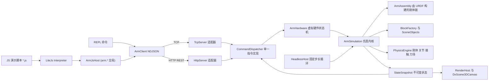

## 用户需求

在 `G:\virtual-lab` 工作区中，把目前只有一个空窗体的 WinForms 工程 `src\VirtualWorkshop\VirtualWorkshop.vbproj` 建设成"六轴机械臂虚拟硬件仿真工作台"，并配套一个命令行上位机 `src\Controller\Controller.vbproj`（内嵌 LiteJs JavaScript 解释器，用 JS 脚本指挥机械臂）。

## 产品概述

工作台加载 `models\six_axis_arm.glb` 与 `six_axis_arm.urdf`，在三维视口中呈现一台与模型一致的六轴机械臂，连同桌面与一堆可抓取的积木。机械臂与积木都受真实的重力、摩擦力、碰撞与关节力矩上限约束：夹爪夹持力不足时积木会滑落，球体能滚动，积木能在斜面上自行下滑。上位机通过 TCP 或 HTTP 向这台"虚拟硬件"发送动作指令，驱动机械臂完成任务；同一份仿真内核还提供无界面的高速模式，供神经网络模型批量训练与测试。

## 核心功能

- 三维工作台窗口：渲染机械臂各连杆、桌面/地面、积木；鼠标可轨道旋转、平移、缩放；显示 TCP 轨迹、坐标轴与碰撞提示；可截图。
- 六轴动力学仿真：每根连杆是独立刚体，通过带角度限位的转轴关节串联，关节由速度/力矩伺服驱动，受重力影响，可被物体阻挡；支持伺服使能、回零、停止、急停、复位、仿真速度倍率。
- 虚拟硬件通信协议：TCP 长连接（请求/响应 + 状态实时订阅）与 HTTP（一次性指令 + 状态查询）两套等价入口。指令覆盖：握手与心跳、读取状态与观测、关节空间运动、笛卡尔直线/点位运动（内部逆解）、实时伺服流控、夹爪开合（可指定夹持力）、积木生成/移除/清空/重置、仿真参数配置（重力、摩擦、步长、随机种子）。
- 积木库：程序化生成圆锥、球、长方体、正方体、半球、圆台、圆柱、棱柱/棱锥等形状，可指定尺寸、质量、摩擦系数与颜色，并具备对应碰撞体与真实物理行为。
- 抓取与搭积木：夹爪手指由力受限的移动副驱动，真实产生法向力与摩擦；可完成"移动到积木上方 → 下降 → 夹紧 → 抬起 → 搬运 → 堆叠"流程。
- 上位机 REPL + JavaScript 脚本引擎：REPL 支持连接/断开、状态表、单条指令、实时监听、并发压测；同时内嵌 LiteJs 解释器，把虚拟硬件能力以 `arm.*` 全局对象注入 JS，脚本可直接 `arm.moveJ([...])`、`arm.state()`、`arm.spawn(...)`。
- JavaScript 演示脚本：`pick_and_place.js`（抓取-搬运-放下）、`build_house.js`（抓取积木按图纸搭房子）、`blocks_demo.js`（生成各类积木并演示滚动/斜面下滑）、`joint_sweep.js`（关节限位扫掠自检）。
- 无界面模式：不创建窗口、不做渲染，按固定步长运行物理，支持实时倍率加速与按步数推进，协议完全可用。
- 状态反馈：6 个关节的角度与角速度、TCP 位姿与速度、夹爪开度与接触力、是否到位、碰撞对、急停状态、仿真时间与步数、积木清单。

## 视觉与交互效果

深色工业控制台风格：左侧大面积三维视口，右侧仪表化状态面板与关节滑块，底部日志与连接状态，操作即时反馈并在碰撞、到位、急停时给出明确视觉提示。

## 技术栈

- 语言与框架：VB.NET，`net10.0-windows`（WinForms + `UseWPF`），`Microsoft.NET.Sdk`，保持现有工程属性与 `MyType=WindowsForms` 不变。
- 三维渲染：`Microsoft.VisualBasic.Drawing.DirectX.DxScene3DCanvas`（DxCanvas.vbproj，程序集 `Microsoft.VisualBasic.Drawing.DirectX.WinForm.dll`）配合 `Microsoft.VisualBasic.Imaging.Drawing3D.Surface`（imaging.NET5）与 `Point3D`。
- 模型加载：`Microsoft.VisualBasic.Imaging.Landscape`（glb 解析、`Gltf.GltfTypes` 公共类型、`Data.SceneModel`、`ModelLoader.LoadModel`）。
- 物理仿真：`Microsoft.VisualBasic.Engine.Physics`（PhysicsEngine.vbproj）的 `PhysicsWorld3D`、`RigidBody3D`、`BoxCollider3D`、`SphereCollider3D`、`ConvexPolyhedronCollider3D`、`HingeJoint3D`、`BallJoint3D`、`ContactSolver3D`。
- 通信：`System.Net.Sockets.TcpListener` 实现 NDJSON 长连接；同一 `TcpListener` 上实现极简 HTTP/1.1（含 SSE 状态流），避免 `HttpListener` 的 URL ACL 权限问题。
- 序列化：`System.Text.Json`（内置）。
- 上位机：`Controller` 工程保持 `net10.0` 控制台，自带最小协议客户端，不引用 WinForms 工程。
- 脚本引擎：`G:\GCModeller\src\runtime\sciBASIC#\vs_solutions\JavaScript\LiteJs.vbproj`（程序集 `Microsoft.VisualBasic.ApplicationServices.VM.JavaScript`，RootNamespace 同名，net10.0，`OptionStrict On`）。**Controller.vbproj 已添加该引用**（现有引用：Core、JSON-netcore5、VisualStudio.NET5、LiteJs）。使用 `Interpreter.DefineGlobal(name, value)` 注入宿主对象、`Interpreter.Run(Parser.Parse(src))` 执行脚本；LiteJs 源码零改动。

## 实现策略

1. **模型与物理分离**：URDF 作为运动学/惯性/限位的唯一事实源（Z-up、单位米），glb 仅作为视觉网格。渲染坐标系、物理坐标系、URDF 坐标系三者统一为 Z-up，基座底面位于 z=0，`world.Gravity=(0,0,-9.81)`。
2. **按连杆分组加载 glb**：Landscape 的 `ModelBuilder` 是 Friend 且丢弃 glTF 节点变换，因此新增 `GlbLinkLoader`：复用 `Landscape.Gltf.GltfRoot/Node/Primitive/Accessor` 类型自行反序列化 JSON chunk、自读 BIN chunk、按 node 名（base_link、J1_Yaw … J6_Roll、Camera、Finger_L/R）分组，应用节点 translation 并做 `(x,y,z)→(x,-z,y)` 的 Y-up→Z-up 转换；同时用 `ModelLoader.LoadModel` 做一次整体加载校验（三角形总数 2704 必须一致），保证仍然"使用 Landscape 加载模型"。
3. **刚体原点取 URDF 惯量原点**：URDF 的 box 中心（等同 `<inertial><origin>`）不在 link 原点，故每个刚体的世界位置取"该 link 惯量原点"，`anchorA = jointOrigin - inertialOriginParent`、`anchorB = -inertialOriginChild`、铰链轴两侧都等于 URDF `<axis>`（joint origin 的 rpy 全为 0）。`InertiaLocal` 直接用 URDF 的 ixx/iyy/izz 对角张量；`AngularDamping` 取 `<dynamics damping>`。
4. **补充 PhysicsEngine 能力（纯新增文件，不改既有 Public API）**：

- `RevoluteJoint3D`：`HingeJoint3D` 的锚点/轴约束 + 绕轴角度上下限（照 `BallJoint3D.SolveConeLimit` 的偏置速度写法），并暴露 `CurrentAngle`、`AngularSpeed`、`SetZeroReference()`。
- `PrismaticJoint3D`：两个正交方向锁死 + 轴向行程限位，暴露 `CurrentExtension`、`LinearSpeed`。
- `JointServo3D`：单自由度关节伺服（位置/速度/力矩三模式、速度环 + 力矩饱和 + 上限软限位 + 使能开关），实现 `IStepHook` 由 `PhysicsWorld3D.Hooks` 每子步自动调用，供转轴与移动副共用。
- `ConvexPrimitives3D`：补 `CreateFrustum`（圆台）、`CreateHemisphere`（半球）、`CreatePrism/CreatePyramid`、`CreatePlank`，均产出严格凸的 `ConvexMesh3D`（顶点 + 面环，右手外向）。

5. **夹持力真实可控**：夹爪手指是独立刚体，通过 `PrismaticJoint3D` 连到 link6，由 `JointServo3D` 在"力模式"下驱动，`MaxForce` 即夹持力上限。法向力被限幅后，库仑摩擦上限随之受限，重力大于摩擦时积木自然滑落，无需任何"抓取后硬绑定"的取巧。
6. **渲染每帧更新**：`Scene.LoadSurfaces` 会把顶点平移成"质心为原点"，而 `SceneTransform` 不使用 `Scene.Center`，直接每帧提交世界坐标会导致整机随质心漂移。做法是：先 `canvas.Scene.LoadSurfaces(worldTriangles)`，再按 `canvas.Scene.Center` 把每个 `Surface.vertices` 平移回去，使渲染模型空间恒等于世界坐标；随后 `canvas.RequestRender()`。轨迹线、坐标轴、碰撞点走 `Direct3D11SceneRenderer` 的 `EnsureLineCapacity/UploadLines` 动态通道（同样减去固定锚点），不触发几何重建。
7. **协议单一事实源**：所有指令在 `CommandDispatcher` 中实现一次（参数校验、状态机检查、返回结果对象），TCP 与 HTTP 只是两个传输适配器；HTTP 用 `POST /api/v1/command`（body 即同一条 JSON）与 `GET /api/v1/state`，等价可读。
8. **单线程仿真 + 线程安全队列**：仿真只在仿真线程推进；网络线程把请求封装成 `PendingRequest` 投递到 `ConcurrentQueue`，仿真 tick 开头批量消费并回填 `TaskCompletionSource`；状态通过不可变快照发布（`Volatile` 引用），订阅推送按客户端独立队列、丢弃旧帧，避免背压拖慢仿真。
9. **headless 与 GUI 共用内核**：`ArmSimulation` 不依赖任何 UI 类型；GUI 用 `Timer` 每帧推进并渲染，headless 用 `Thread.Sleep` 按实时倍率推进，并支持 `sim.step` 精确步进（在 `world.Step(world.FixedDt)` 上循环调用，规避 `Step` 内部"单帧最多 4 步"的上限）。
10. **JavaScript 宿主桥（Controller 侧，LiteJs 零改动）**：

    - `Scripting/ArmJsHost.vb`：纯 CLR 门面类，构造时接收 `ArmClient`，所有方法**同步阻塞**调用 TCP（LiteJs 无事件循环，宿主方法内阻塞 IO 完全合法）。通过 `engine.DefineGlobal("arm", host)` 注入，走 `ClrInterop` 反射桥：`Public` 方法与属性自动成为 JS 成员，异常被规范化为可 `catch` 的 JS 错误（`name` = .NET 异常类型名，`e.clrException` 可还原原始异常），返回值经 `ClrConvert.ToJs`。
    - **返回值编组硬约束**：JS 侧要 `.map/.filter/.forEach/.length/下标`，返回值必须是 `List(Of Object)`（→ 真 JS 数组，完整 Array.prototype）或 `Dictionary(Of String, Object)`（→ 真 JS 对象）。返回 `Double()` / `List(Of Double)` 只会得到 `ClrObject` 代理（有 `.length`/`[i]`/`for...of`，但**没有** `.map`）。
    - **参数方向**：JS 数组（`List(Of Object)`）可自动转成 `Double()` / `List(Of Double)`；JS 对象（`Dictionary(Of String, Object)`）只在参数类型为 `Object` 时原样传入，或目标类型可赋值时通过。
    - **不允许把 JS 回调传给 CLR**：`ClrConvert.ToClr` 对 `Func`/`Action` 目标类型直接抛 `DelegateParameterError`。因此所有"等待/回调"类 API 必须是**条件式同步方法**（`arm.waitMotion(id, timeoutMs)`、`arm.waitSettled(...)`、`arm.waitGripContact(...)`），绝不能设计成 `arm.onUpdate(fn)`。
    - `Scripting/JsScriptRunner.vb`：`New Interpreter(New ConsoleIO())` → 注入 `arm`（和少量 `lab` 辅助，如 `lab.sleep/args`）→ `Run(Parser.Parse(source))`。`ParseException` 打印行/列，`JsRuntimeException` 打印 `ex.Stack`（Node 风格 JS 帧），退出码 1。`Interpreter` 是单线程对象且 `JsRuntime.Io` 是进程级静态，故只创建一个引擎实例、只在主线程运行。
    - 脚本三个入口：`Controller.exe --js <path>`、REPL 内 `js <path>`、`--eval "<code>"`。`scripts\*.js` 随 Controller 输出复制。脚本内 `console` / `JSON` / `Math` / `Array` / `String` / `Promise` 等内建对象全部可用，便于用 `JSON.stringify` 打印状态。
    - VB 侧保留 `DemoScripts.vb` 作为无 JS 环境时的回退演示，但**对外演示以 JS 脚本为主**。

## 性能与可靠性

- 三角形规模 2704，GPU 几何每次重建约 0.1 ms 级；渲染侧仅在关节角度变化超过 0.001 rad 或物体位移超过 0.2 mm 时重建，静止时完全不重建，动态刷新上限 60 Hz。
- 每帧需分配约 8 千个小对象（三角形顶点），全部落在 Gen0，实测可控；必要时按材质缓存 `SolidBrush`，避免每帧新建画笔。
- 物理：8 个机械臂刚体 + 默认 12 个积木，宽相位 O(n²) 完全够用；`Iterations=20`、`Substeps=4`、`WarmStarting=True`，保证夹持与堆叠稳定。
- 网络：单连接请求-响应 + 30 Hz 状态推送；每客户端发送队列上限 4 帧，超出丢旧帧；所有槽位有超时，避免慢客户端阻塞。
- 错误处理：指令返回结构化错误码（`unknown_command`、`bad_params`、`not_enabled`、`estop_active`、`ik_unreachable`、`joint_limit`、`busy`、`timeout`）；物理异常（NaN）检测后自动 `reset` 并上报 `sim_fault`；所有网络回调异常只记录日志，不使进程崩溃。
- 无破坏性改动：PhysicsEngine 只新增文件；Landscape、DXApi、DxCanvas、LiteJs 零改动；`VirtualWorkshop.vbproj` 只新增模型复制项，`Controller.vbproj` 只新增 `scripts\*.js` 复制项。

## 系统架构



## 目录结构

```
G:\virtual-lab\
├── models\                                        # 已有模型，作为内容复制到输出目录
├── src\
│   ├── VirtualWorkshop.slnx                        # [MODIFY] 无新增工程，保持不变
│   ├── Controller\
│   │   ├── Controller.vbproj                       # [MODIFY] 复制 scripts\*.js 到输出；保持已有引用（含 LiteJs）
│   │   ├── Program.vb                              # [MODIFY] 参数解析（--connect/--js/--eval/--script/--bench）+ REPL 主循环 + 退出码
│   │   ├── ArmClient.vb                            # [NEW] TCP NDJSON 请求/响应客户端 + 订阅接收线程 + HTTP 一次性调用；断线重连与请求超时
│   │   ├── CommandParser.vb                        # [NEW] REPL 命令词法：help/connect/state/watch/movej/movej_rel/movel/home/grip/spawn/remove/clear/config/estop/reset/sleep/js/script/bench/quit，支持行内 JSON 参数
│   │   ├── StatusView.vb                           # [NEW] 状态表渲染（关节角/速度、TCP 位姿、夹爪、碰撞、仿真时间），ANSI 着色，watch 模式低闪刷
│   │   ├── DemoScripts.vb                          # [NEW] VB 侧内置演示序列（无 JS 时的回退）：抓取-搬运-堆叠、关节极限扫掠
│   │   ├── ScriptRunner.vb                         # [NEW] 读取 .vlab 文本脚本逐行回放，失败即停并打印错误码
│   │   ├── Scripting\
│   │   │   ├── ArmJsHost.vb                        # [NEW] JS 宿主门面：arm.connect/state/moveJ/moveL/grip/spawn/wait*/config…
│   │   │   └── JsScriptRunner.vb                   # [NEW] LiteJs 引擎装配、DefineGlobal 注入、ParseException/JsRuntimeException 输出
│   │   └── scripts\
│   │       ├── pick_and_place.js                   # [NEW] 抓取-搬运-放下演示（含到位等待与力控夹持）
│   │       ├── build_house.js                      # [NEW] 按图纸抓取积木搭小房子（逐层堆叠）
│   │       ├── blocks_demo.js                      # [NEW] 生成球/圆锥/圆台/半球/圆柱 + 斜面滚落演示
│   │       └── joint_sweep.js                      # [NEW] 六关节限位扫掠自检
│   └── VirtualWorkshop\
│       ├── VirtualWorkshop.vbproj                  # [MODIFY] 复制 models\*.glb/*.urdf 到输出；保持引用不变
│       ├── ApplicationEvents.vb                    # [MODIFY] MyApplication.Startup：解析命令行，--headless/--selftest 时 Cancel 主窗体并运行对应宿主
│       ├── My Project\Application.Designer.vb      # [MODIFY] 仅在 Startup.Cancel 不生效时改为自定义入口，正常情况不改
│       ├── FormVirtualLab.vb                       # [MODIFY] 工作台主窗体：布局、事件绑定、仿真定时器、协议开关、状态刷新、日志
│       ├── FormVirtualLab.Designer.vb              # [MODIFY] 代码构建控件（DxScene3DCanvas、工具栏、关节面板、日志列表、状态栏）
│       ├── Configuration\
│       │   └── SimulationOptions.vb                # [NEW] 命令行与配置解析：--model --urdf --port --http-port --headless --selftest --realtime --no-server --blocks
│       ├── Model\
│       │   ├── UrdfModel.vb                        # [NEW] URDF 解析（link/joint/limit/inertia/collision/visual），含 XDocument 解析与校验
│       │   ├── LinkMesh.vb                         # [NEW] 单连杆视觉网格：局部三角面数组、材质颜色、惯量原点与 node 变换
│       │   ├── GlbLinkLoader.vb                    # [NEW] 读 GLB header/JSON/BIN，复用 Landscape.Gltf 类型，遍历节点树按连杆分组并做 Y-up→Z-up；用 ModelLoader 校验总面数
│       │   ├── ArmAssembly.vb                      # [NEW] 由 URDF+网格构建装配体：关节定义、惯量原点、锚点/轴换算、零位姿态、FK、TCP 位姿
│       │   └── Kinematics.vb                       # [NEW] 数值 IK（阻尼最小二乘 + 关节限位钳制 + 迭代收敛判据）与 TCP 插补
│       ├── Simulation\
│       │   ├── ArmSimulation.vb                    # [NEW] 仿真内核：构建 PhysicsWorld、刚体链、转轴关节与伺服、桌面、积木、每帧步进、碰撞与故障检测
│       │   ├── ArmHardware.vb                      # [NEW] 虚拟硬件语义层：使能/急停/模式/运动队列/到位判定/超时/夹爪力控/场景操作
│       │   ├── BlockFactory.vb                     # [NEW] 积木规格与生成：形状/尺寸/质量/摩擦/颜色 → ConvexMesh + Collider + 渲染三角面
│       │   ├── SceneObjects.vb                     # [NEW] 场景物体注册表与快照（id、类型、位姿、尺寸、是否被抓）
│       │   ├── StateSnapshot.vb                    # [NEW] 不可变状态快照与 JSON 序列化（q、qd、tcp、gripper、collisions、time、step）
│       │   └── SimulationClock.vb                  # [NEW] 固定步长推进、实时倍率、累计统计（步/秒、物理耗时）
│       ├── Protocol\
│       │   ├── ProtocolText.vb                     # [NEW] 指令名、错误码、事件名、字段名常量（单一事实源）
│       │   ├── CommandDispatcher.vb                # [NEW] 所有指令的实现与参数校验，返回统一响应对象；TCP/HTTP 共用
│       │   ├── TcpServer.vb                        # [NEW] NDJSON 长连接服务、按行解析、并发连接管理、状态订阅推送
│       │   ├── HttpServer.vb                       # [NEW] 极简 HTTP/1.1：POST /api/v1/command、GET /api/v1/state、GET /api/v1/events（SSE）、GET /health
│       │   └── JsonText.vb                         # [NEW] System.Text.Json 读写助手（大小写不敏感、数值数组、错误对象）
│       ├── Rendering\
│       │   ├── RenderHost.vb                       # [NEW] DxScene3DCanvas 生命周期、相机初始视角、帧请求节流、渲染开关
│       │   ├── SceneBuilder.vb                     # [NEW] 刚体位姿 → 世界三角面 → Surface 列表；质心补偿；按材质缓存画刷；碰撞高亮
│       │   ├── OverlayRenderer.vb                  # [NEW] 动态线通道：TCP 轨迹、世界坐标轴、碰撞接触点十字、夹爪力矢量
│       │   └── MeshTessellator.vb                  # [NEW] ConvexMesh3D 的面环 → 三角面（扇形三角化）与法线计算
│       ├── Headless\
│       │   └── HeadlessHost.vb                     # [NEW] 无界面运行：启动协议服务、固定步长循环、实时倍率、Ctrl+C 优雅退出
│       └── Diagnostics\
│           └── SimSelfTest.vb                      # [NEW] --selftest 断言：URDF 解析、GLB 面数、FK、限位、重力落体、抓取滑落、协议往返
```

## 关键契约

协议消息信封（TCP 每行一条 JSON，HTTP body 同构）：

```
' 请求:  {"id": 1, "cmd": "movej", "params": {"q": [0,0,0,0,0,0], "speed": 0.5, "wait": true}}
' 成功:  {"id": 1, "ok": true,  "result": {"accepted": true, "motion_id": 7}}
' 失败:  {"id": 1, "ok": false, "error": {"code": "ik_unreachable", "message": "..."}}
' 事件:  {"event": "state", "seq": 128, "data": {"time": 2.13, "q": [...], "qd": [...], "tcp": [x,y,z,rx,ry,rz], "gripper": {...}, "collisions": [...]}}
```

JavaScript 宿主 API（Controller 注入的全局 `arm`，全部返回 `Dictionary(Of String, Object)` / `List(Of Object)`，保证 JS 侧 `.map/.length/属性访问` 可用）：

```
arm.connect(host?, port?)                  -> {ok, version, joints:6}
arm.state()                                -> {time, step, q, qd, tcp:{x,y,z,rx,ry,rz}, gripper:{opening,force,holding}, collisions, estop}
arm.moveJ(q, options?)                     -> {accepted, motion_id}      // options: {speed, wait}
arm.moveJRel(dq, options?)
arm.moveL(x, y, z, options?)               -> {accepted, motion_id}      // 笛卡尔直线，服务端数值 IK
arm.moveTo(pose, options?)                 // pose: {x,y,z,rx,ry,rz}
arm.home(options?) / arm.stop() / arm.estop() / arm.reset()
arm.enable(on?)
arm.grip(force) / arm.release() / arm.gripWidth(w)
arm.waitMotion(motion_id, timeout_ms?)     -> {done, reason}             // 条件式等待，替代 JS 回调
arm.waitSettled(speed_eps?, timeout_ms?)   -> {settled, max_speed}
arm.waitGripContact(timeout_ms?)           -> {contact, force}
arm.spawn(shape, size, position, options?) -> {id, ...}                  // shape: box|sphere|cylinder|cone|frustum|hemisphere|prism|pyramid
arm.remove(id) / arm.clear() / arm.objects()
arm.config(key, value) / arm.setRealtime(factor)
arm.sleep(ms)                              // 宿主阻塞，仿真继续推进
arm.log(msg)
```

补充 PhysicsEngine 的核心新增类型：

```
Namespace Joints3D
    Public Class RevoluteJoint3D : Implements IConstraint3D
        Sub New(a As RigidBody3D, b As RigidBody3D,
                anchorA As Vector3, anchorB As Vector3,
                axisA As Vector3, axisB As Vector3,
                lowerLimit As Double, upperLimit As Double)
        Public ReadOnly Property CurrentAngle As Double      ' 相对零位的绕轴角，弧度
        Public ReadOnly Property AngularSpeed As Double      ' 相对角速度，弧度/秒
        Public ReadOnly Property LimitError As Double        ' 违反限位量，0 表示未越界
        Public Property Baumgarte As Double
        Public Property BiasSpeedLimit As Double
        Public Sub SetZeroReference()
    End Class

    Public Enum ServoMode3D
        Disabled : Position : Velocity : Torque
    End Enum

    Public Class JointServo3D : Implements IStepHook
        Sub New(dof As IJointDof3D, Optional mode As ServoMode3D = ServoMode3D.Disabled)
        Public Property MaxVelocity As Double     ' 弧度/秒 或 米/秒
        Public Property MaxForce As Double        ' 牛顿 或 牛米，力模式下的夹持力上限
        Public Property Stiffness As Double
        Public Property Damping As Double
        Public Property Target As Double
        Public Sub BeforeSubstep(dt As Double) Implements IStepHook.BeforeSubstep
    End Class
End Namespace
```

## 执行要点

- **glTF 坐标系**：glb 是 Y-up（节点 translation `J1_Yaw=(0,0.132,0)`），必须转换 `(x,y,z)→(x,-z,y)` 才能与 URDF（Z-up，`j1 origin z=0.132`）对齐；Base 顶点 y 范围 0.014~0.132、J2 顶点 x 范围 0~0.215 已用于校核。
- **不要用 `canvas.LoadSurfaces`**：它会 `controller.Reset()+FitView()` 重置相机，动画必须走 `canvas.Scene.LoadSurfaces` + `canvas.RequestRender`。
- **质心补偿**：`Scene.Surfaces` 返回内部数组、`Surface.vertices` 可写，加载后按 `Scene.Center` 平移回去即可固定世界原点；`scene.Lines` 全程不用（改走 `UploadLines`），避免 `LoadSurfaces` 内部的 `TranslateLines` 干扰。
- **不新增共享工程**：Controller 自带最小协议实现，避免把 WinForms 依赖拖进控制台；两份常量以 `ProtocolText` 为准，控制器侧只复制指令名字符串。
- **VB 语法约束**：Module 成员不能加 `Shared`；局部变量不能与类型名/属性名同名（大小写不敏感）；`Math.xxx` 可能被同名模块遮蔽需写 `System.Math.xxx`；`Dim x As String = 属性` 可能触发 BC42104（先调私有 `EnsurePaths()`）。
- **无界面入口**：优先用 `MyApplication.Startup` 事件里 `e.Cancel = True` 后运行 `HeadlessHost`/`SimSelfTest` 并 `Environment.Exit(code)`；若该方式不生效，退化为 `<StartupObject>` 自定义 `Main` 模块并 `<MyType>Empty`。
- **回归防线**：所有物理新增文件只做加法；渲染若取不到 `Direct3D11SceneRenderer`（GPU 不可用回退 Direct2D），自动关闭动态叠加层而不是抛异常。
- **LiteJs 约束（决定 JS API 形状）**：
- `Interpreter.Run(program)` 是 `Sub`（拿不到返回值），要值用 `Evaluate(program)`；执行源码只能 `Run(Parser.Parse(src))`，没有字符串重载。
- 命名空间：`Microsoft.VisualBasic.ApplicationServices.VM.JavaScript`（`Interpreter/Parser/ParseException`）与 `...JavaScript.Runtime`（`ScriptIO/ConsoleIO/LogTextIO/JsRuntimeException/JsError/ClrHost/ClrInterop`）。
- 宿主注入：`engine.DefineGlobal(name, value)`；CLR 对象走反射桥（Public 方法/属性自动可用），委托（`Func(Of Object(), Object)`）则变成 JS 函数。
- **返回值必须是 `List(Of Object)` / `Dictionary(Of String, Object)`** 才能得到原生 JS 数组/对象（`.map` 等可用）；`Double()` 只能当 `ClrObject` 用。
- **JS 回调不能作为 `Func`/`Action` 参数传给 CLR**（会抛 DelegateParameterError）⇒ 等待必须做成 `waitXxx()` 同步条件方法。
- 宿主方法里做阻塞网络 IO 合法；但不要在线程里回调解释器（无事件循环，`Interpreter` 不能跨线程并发使用）。
- 优先用 CLR 类（异常自动规范化、JS 可 `catch`），而不是裸委托（委托抛出的原生异常会穿透解释器）。
- 演示脚本必须能独立跑通：`Controller.exe --connect 127.0.0.1:8900 --js scripts/pick_and_place.js`。

## 设计风格

深色工业控制台（Dark Industrial Cockpit）：以近黑蓝为底，青蓝为主色、琥珀为强调色，卡片化分区，细描边与轻微发光勾勒三维视口，数字使用等宽字体形成仪表感。整体追求"专业机器人示教器 + 实时示波器"的观感，而非普通表单。

## 布局（单窗体，可缩放）

- **顶部工具栏（高 56）**：左侧品牌区（工作台名称 + 仿真状态灯）；中部操作按钮（启动/停止服务、伺服使能、回零、停止、急停、复位场景）；右侧模式与倍率（物理模式、实时因子输入、TCP/HTTP 端口与连接数徽标）。按钮悬停有 120ms 底色渐变，急停按钮常驻红色描边。
- **主区三栏**：左 68% 为三维视口（无边框，右上角浮动 HUD 显示 FPS、步数、物理耗时、碰撞计数，左下角浮动坐标轴与缩放提示）；右侧 32% 为仪表面板，纵向堆叠四张卡片：①关节状态（6 行，每行：关节名、角度数值、横向滑轨显示当前角与限位区间、速度与力矩条形）②TCP 位姿（x/y/z 与 rx/ry/rz 六格数字，精确到 0.1 mm / 0.1°）③夹爪（开度环、接触力数值、开/合按钮、夹持力输入）④场景物体（积木列表：类型、尺寸、位姿、是否被抓，双击高亮）。
- **底部区（高 132）**：左 60% 为滚动日志（时间戳 + 级别色标 + 消息，指令与错误分行着色）；右 40% 为迷你事件流（最近 8 条协议事件：连接、指令、碰撞、到位、急停）。最底一行状态栏：模型路径、URDF 关节数、三角形数、仿真步长、内存与 GC。

## 交互

- 三维视口：左键拖拽轨道旋转、右键拖拽平移、滚轮缩放、`F` 适配、`R` 复位、`S` 截图；点击物体高亮并在右侧卡片定位其条目。
- 关节滑块拖动即发送实时伺服目标，松开后回到"保持"；滑块越限时变琥珀并提示越界。
- 碰撞发生时，接触点绘制红色十字并让对应连杆轮廓闪烁 300ms；夹持滑落时夹爪卡片短暂显示"SLIP"警示。
- 所有网络请求在日志区留下一条可展开的记录（请求 id、耗时、错误码），便于排查。

## 响应式与状态

窗口最小 1180x720；三栏宽度按 0.68/0.32 自适应，右侧面板宽度夹在 340~480；底部区在高度不足 640 时折叠为仅日志。无连接时工具栏显示灰色"离线"徽标，有连接时显示脉冲绿点与客户端数。

## Agent Extensions

### SubAgent

- **code-explorer**
- Purpose: 在实现阶段精确核对底层库的调用点与签名（PhysicsEngine 的接触/关节内部实现、DXApi 的动态线通道、Landscape 的 glTF 类型字段、LiteJs 的 `ClrInterop` 编组规则），避免凭记忆写错 API。
- Expected outcome: 给出可直接编译的调用片段与文件行号，确保新增关节/伺服/渲染/JS 宿主代码一次通过编译。