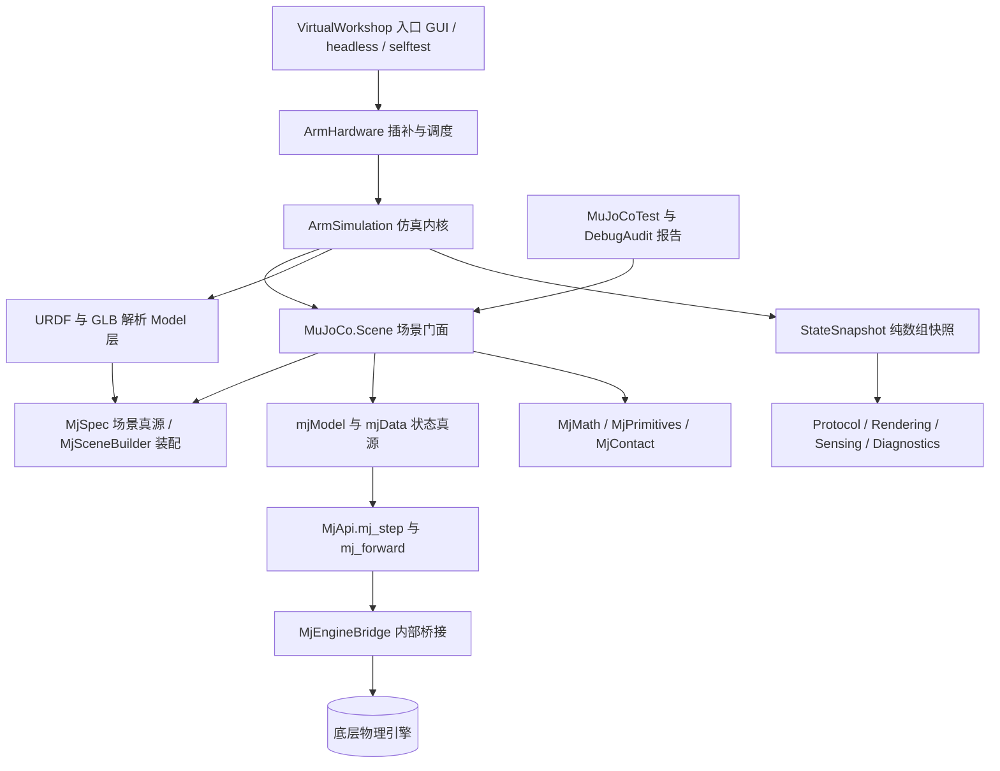

## 用户需求

- 将 `VirtualWorkshop` 对底层物理引擎项目的直接引用，改为对 `MuJoCo` 封装项目的引用。
- 基于 `VirtualWorkshop` 现有的仿真模拟需求，补齐 `MuJoCo` 中缺失的 API。
- 仿真内核完全改用 MuJoCo 方式：以 MJCF 模型描述场景、以仿真状态数组承载位姿、以单步推进驱动物理。
- 源码彻底隔离：工程内不再出现底层引擎命名空间，所有物理与数学类型来自 MuJoCo 或 System.Numerics，并移除项目级直接引用。
- 验收：解决方案编译通过、现有自检全部通过、改动前后仿真状态快照行为一致、新增 API 的 console 测试报告。

## 产品概述

改造后仍是一个六轴机械臂虚拟工作台：可加载 URDF 与 GLB 模型，装配六轴臂、地面、夹爪、积木、烧瓶、弹簧平台，支持关节指令、夹爪开合、物体增删、复位与急停，输出确定性的仿真状态快照，并提供夹爪相机渲染、TCP/HTTP 指令、窗口界面、无界面运行与自检三种入口。物理全部由 MuJoCo 封装层驱动，界面外观与交互保持不变。

## 核心功能

- MJCF 场景装配与建模：六轴臂连杆、转轴与滑台关节、夹爪、地面、积木、烧瓶、弹簧平台的场景构建。
- 仿真推进与双模式：运动学精确轨迹与动力学驱动、关节伺服、弹簧、接触查询、定步长推进、急停与复位。
- 运行时场景变更：物体生成/移除/清空、平台创建/拆除、按名保存与恢复状态。
- 状态与观测：纯数组状态快照、相机位姿与软光栅化图像、协议指令查询与配置。
- 数学与几何工具：向量/四元数运算、姿态转换、凸网格图元生成、URDF 与 GLB 装配映射。
- 可验证性：基线快照对比、自检套件、新增 API 测试与 HTML 测试报告。

## 技术栈选型

- 语言/项目：VB.NET，SDK 风格项目。`MuJoCo`、`MuJoCoTest` 为 `net10.0`，`VirtualWorkshop` 为 `net10.0-windows`（WinExe，WinForms + WPF），平台 `AnyCPU;x64`。
- 仿真内核：复用现有 `MuJoCo` 封装 `MjSpec` / `MjcfParser` / `MjcfCompiler` / `mjModel` / `mjData` / `MjApi.mj_step` / `MjMath` / `MjType` / `Runtime.MjEngineBridge`；其后端仍为底层引擎，但仅在 `MuJoCo` 内部可见。
- 数学：统一 `System.Numerics`（`Vector3` / `Quaternion` / `Matrix4x4`），扩展 `MjMath` 补齐便捷运算，遵循库「对外只暴露 System.Numerics 类型」的既有约定。
- 网格与资产：复用 `MuJoCo.Geometry`（`ConvexHull3D` / `StlReader`），新增图元生成器；URDF/GLB 解析保留在 `VirtualWorkshop` 的 Model 层（使用 imaging.Landscape.Gltf 等，非引擎命名空间）。
- 测试：`MuJoCoTest` 控制台 + `DebugAudit`（`Microsoft.VisualBasic.ApplicationServices.Debugging`），导出 HTML 报告，退出码等于失败数。
- 不引入新第三方依赖，不把 Windows 专属依赖带入 `net10.0` 的 `MuJoCo`。

## 实现思路

**总体策略**：在 `MuJoCo` 增加一个「场景门面」层 `MuJoCo.Scene`，把 MJCF 编译与数组式状态封装成 `VirtualWorkshop` 需要的对象式、可动态变更操作；`VirtualWorkshop` 仿真内核改用该门面与 `mj_step`，外围层统一到 `System.Numerics`；最后移除直接引擎引用并做四项验收。

**关键技术决策与权衡**：

1. **门面而非同名兼容层**。不复制一套与引擎同名的对象类型，而以 `MjSpec` 为场景唯一真源、`mjData` 数组为状态唯一真源；对外句柄按名称解析（name-based handle），因此重建模型后句柄依然有效。收益是语义与 MuJoCo 一致、单一真源、可扩展；代价是动态增删物体需要重建模型。
2. **受控重建而非预分配对象池**。`Spawn/Remove/Clear/Reset` 属低频用户指令，采用「修改 `MjSpec` → `mj_compile` + `mj_makeData` → 按名恢复 qpos/qvel」；热路径 `mj_step` 绝不触发重建。重建复杂度 O(nbody+ngeom)，仅发生在结构变更；单步推进为一次 `mj_step`。避免对象池带来的形状固定、禁用体污染接触与渲染、计数语义失真等问题。
3. **kinematic 能力落到模型层**。`MjsBody` 增加 `Kinematic` 标志，经 `MjcfCompiler` 写入 `mjModel.body_kinematic`，`MjEngineBridge` 装配时对其调用 `SetStatic`；运动学轨迹由门面在步进前写入 `qpos` 并配合 `mj_forward` 刷新派生量。比超高增益 position 执行器更精确，更贴近现有默认行为。
4. **伺服/弹簧/接触**。伺服映射到已支持的 position 执行器（`MjsActuator` + `d.ctrl`）；弹簧用纯托管计算写入 `mjData.xfrc_applied` / `qfrc_applied`，不改模型；接触用 `mjData.ncon` / `contact` 配合 `geom_bodyid` 与名称表还原命名接触对，并保留 kinematic/static 场景的几何接触兜底（现有 `DetectGroundContacts` / `FingersTouchingObject` 语义）。
5. **数学统一**。用 `System.Numerics` 值类型 + `MjMath` 扩展替换引擎的 `Vector3`（可空 Class）与 `Math3D`，不自建新向量类型，减少技术债。代价是需逐一改写可空判断与四元数分量顺序（引擎为 x,y,z,w；MuJoCo 为 w,x,y,z，统一经 `MjMath.Quat` / `WriteQuat` 转换）。
6. **URDF/GLB 装配边界**。解析留在 `VirtualWorkshop` Model 层，避免把 imaging/Drawing 依赖拖进 net10.0 类库；`MuJoCo` 提供中性 `MjSceneSpec` DTO、`MjSceneBuilder` 装配 API 与 `AddMesh(vertices, faces)` 便捷重载。`VirtualWorkshop` 把解析结果映射为 DTO，保持关注点分离。

**性能与可靠性**：门面缓存 name→id 字典，重建时统一失效重算，避免每步线性查找；状态保存/恢复用 `Double()` 批量拷贝，避免重建时的对象分配风暴；`StepsPerSecond=120`、`Substeps=8` 由 MJCF option 与桥接选项映射；几何层单精度、动力学层双精度沿用既有语义，快照继续以 `Double()` 序列化以保持协议字段不变；编译失败沿用 `MjException` / `errorText`，重建失败回滚到上一份可用 model/data，避免仿真线程崩溃；越界索引沿用库内既有异常语义。

**避免技术债**：复用 `MjSpec`/`MjApi`/`MjMath`/`MjcfCompiler`/`MjEngineBridge` 与 `MuJoCoTest` 的 `DebugAudit` 模式；不改变 `MuJoCo` 上层 C 风格 API 的公开签名（以新增为主）；不重写零引擎依赖的 `FormVirtualLab` / `UiTheme`。

## 实施要点

- **顺序前置**：先导出改动前基线快照，再改代码，否则「行为一致性」无可比基准。
- **热路径**：每 tick 一次 `mj_step`；门面只做数组切片与名称缓存查找，不在步进循环里编译或打日志。
- **四元数约定**：`mjData.xquat` 与 body `Quat` 为 w,x,y,z；`System.Numerics.Quaternion` 为 x,y,z,w；统一经 `MjMath` 转换，快照 `TcpQuaternion` 仍输出 [qx,qy,qz,qw]。
- **可空性迁移**：`Vector3` 由可空 Class 变为值类型，所有 `Is Nothing` 判断改成显式默认语义（重点 `StateSnapshot.ToArray`、`ArmSimulation`、`BlockFactory`）。
- **日志**：沿用现有 `Console.WriteLine` 与自检输出；仅重建与编译失败时输出可执行的 `errorText`，不打印整份模型。
- **影响面控制**：`MuJoCo` 现有公开签名保持不变；`Runtime` 中泄漏引擎类型的公开成员收窄为 `Friend` 或提供纯托管替代，确保 `VirtualWorkshop` 永不接触；`Particles.vbproj` 源码零使用，可一并移除（可选）；`.slnx` 的 framework/world 仍保留底层引擎项目（`MuJoCo` 依赖它），仅删 `VirtualWorkshop` 项目级引用；`GlbLinkLoader.vb` 用的是 `System.Numerics`，勿误改。
- **兼容性**：保持三种入口、协议命令与快照 schema 不变，headless 用于确定性回归。

## 架构设计

数据流：用户指令 → `CommandDispatcher` → `ArmSimulation` → `MjScene.Step` → `MjApi.mj_step` → `mjData` 数组 → 门面句柄 → `StateSnapshot` → 协议/渲染/自检；结构变更 → `MjSpec` 变更 → 受控重建 → 按名恢复状态。



## 目录结构

改动跨三个项目：`src/MuJoCo`（新增场景门面并补齐 API）、`src/VirtualWorkshop`（重写仿真内核并迁移 24 个耦合文件）、`src/MuJoCoTest`（新增用例与报告），外加项目文件、文档与基线。

```
src/
├── MuJoCo/
│   ├── Scene/
│   │   ├── MjSceneSpec.vb         # [NEW] 中性场景描述 DTO：MjSceneOptions（gravity/timestep/substeps/iterations/baumgarte/slop/warmstarting/allowSleep）、MjBodySpec、MjJointSpec、MjGeomSpec、MjActuatorSpec。仅用 Double 数组与 System.Numerics，不含任何引擎类型；供 VirtualWorkshop 把 URDF/GLB 解析结果映射进来。
│   │   ├── MjSceneBuilder.vb      # [NEW] 装配器：把 MjSceneSpec 转成 MjSpec 树（AddBody/AddJoint/AddGeom/AddActuator），提供 AddMesh(name, vertices, faces) 便捷重载与凸包化简（复用 Geometry.ConvexHull3D，遵守 600 点上限）。承担 URDF/GLB 到 MJCF 的映射语义。
│   │   ├── MjScene.vb             # [NEW] 场景门面：持有 MjSpec + mjModel + mjData；提供 Build/Reset/Step/Advance/SpawnBody/RemoveBody/ClearObjects/ClearVelocities/Contacts/Gravity/Bodies/FixedDt。结构变更时改 MjSpec 后受控重建并保存恢复 qpos/qvel；缓存 name→id，重建时刷新。步进只调 MjApi.mj_step，热路径不重建。
│   │   └── MjHandles.vb           # [NEW] 名称句柄与能力封装：MjBody（Position/Orientation/Velocity/AngularVelocity/Label/Mass/Size/IsStatic，读写 xpos/xquat/cvel/body_mass）、MjServo（Target/Stiffness/Damping/MaxForce/Tolerance/CurrentPosition/LastForce/Enabled）、MjSpring（锚点/刚度/阻尼/最大力/Compression/CurrentForce，写入 xfrc_applied）、MjContact（命名接触对与位置，含几何兜底）。
│   ├── Geometry/
│   │   └── MjPrimitives.vb        # [NEW] 纯 System.Numerics 凸网格生成器：box/sphere/cylinder/cone/wedge/disc/frustum/hemisphere/prism/pyramid 顶点与三角面，替换引擎 ConvexMesh3D.Create 系列与 ConvexPrimitives3D.Create 系列，供积木与烧瓶使用。
│   ├── Import/
│   │   └── MjUrdf.vb              # [NEW] 轻量 URDF 读取（System.Xml.Linq，纯托管、无 imaging 依赖）：解析 link/joint/origin/axis/limit/inertia 为 MjSceneSpec；网格三角面仍由宿主从 GLB 注入。
│   ├── MjMath.vb                   # [MODIFY] 补齐纯 System.Numerics 便捷函数：Length/Normalize/Dot/Cross/Slerp/ToRpy/ToArray/Diagonal/MultiplyLeft/Rotate/Unrotate，替换引擎 Vector3Math 与 Math3D；保持既有 Vec/Quat/WriteQuat/Mat9/WorldOf 签名不变。
│   ├── MjSpec.vb                   # [MODIFY] MjsBody 增加 Kinematic 标志与碰撞组透传；增加 AddMesh(name, vertices, faces) 便捷重载；Compile 保持不变。
│   ├── MjModel.vb                  # [MODIFY] 增加 body_kinematic 数组与必要的 geom_bodyid 索引，扩展 Allocate；保持既有字段名与计数不变。
│   ├── Compiler/MjcfCompiler.vb    # [MODIFY] 编译期把 Kinematic 与内联 mesh 顶点/面写入 mjModel；错误仍汇总进 MjErrorBuffer。
│   ├── Runtime/MjEngineBridge.vb   # [MODIFY] 装配时对 kinematic body 调用 SetStatic；把泄漏引擎类型的公开成员收窄为 Friend 或提供纯托管替代；ApplyOptions 支持 substeps/baumgarte/slop/warmstarting/allowSleep 映射。
│   ├── MjApi.vb                    # [MODIFY] 保持 mj_step/step1/step2/forward 语义；确保 kinematic 分支与 ncon/contact 回读对门面可用，不改公开签名。
│   └── Docs/
│       ├── MjApiMapping.md          # [MODIFY] 追加 Scene 门面映射、kinematic/弹簧/接触语义差异与新增限制。
│       └── MjcfSupport.md           # [MODIFY] 追加 kinematic 标志、内联 mesh、装配扩展的支持说明。
├── VirtualWorkshop/
│   ├── Simulation/
│   │   ├── ArmSimulation.vb        # [MODIFY] 内核重写：Build/Reset/StepOnce/Advance/CreatePlatform/SpawnBlock/RemoveObject/ClearObjects/EmergencyStop/CaptureState 全部基于 MjScene 与 mjData 数组；World 属性改为 MjScene 供宿主/协议穿透访问；保留 kinematic/dynamic 双模式与几何接触兜底。
│   │   ├── SimulationAdapter.vb    # [NEW] URDF/GLB 到 MjSceneSpec 的映射适配器，隔离 Model 层解析与 Scene 装配。
│   │   ├── ArmHardware.vb          # [MODIFY] 插补与 Tick 保留；向量/四元数/Slerp 换 System.Numerics + MjMath；Spawn 签名去引擎类型。
│   │   ├── BlockFactory.vb         # [MODIFY] 积木形状改由 MjPrimitives + MjSceneBuilder 生成 MjGeomSpec，返回 MjBody 句柄；保留 RestingPosition 落点计算。
│   │   ├── FlaskAssets.vb          # [MODIFY] 由 GLB 凸包生成顶点/面注入 MjSceneSpec，替换 ConvexMesh3D。
│   │   ├── SpringPlatform.vb       # [MODIFY] 板/挡块/四角弹簧改用 MjScene + MjSpring，保留倾角/弹力查询与 Detach，删除无效 ForceFields3D 导入。
│   │   ├── ObjectPosture.vb        # [MODIFY] 由 MjBody 位姿判定正立/倾倒/掉落。
│   │   ├── StateSnapshot.vb        # [MODIFY] ToRpy/ToArray 改接 System.Numerics 类型；StateSnapshot 字段与 JSON schema 保持不变，作为行为对比基准。
│   │   ├── SimulationHost.vb       # [MODIFY] FixedDt 改从 MjScene 读取，其余调度不变。
│   │   ├── SimulationPreset.vb     # [MODIFY] 按新签名微调 preset 装配顺序。
│   │   └── SimulationClock.vb      # [MODIFY] 基本不变，确认无引擎类型。
│   ├── Model/
│   │   ├── UrdfModel.vb            # [MODIFY] 向量字段换 System.Numerics，URDF 解析逻辑保留。
│   │   ├── ArmAssembly.vb          # [MODIFY] Pose3D 链与 rpy 到四元数换 System.Numerics + MjMath。
│   │   ├── Kinematics.vb           # [MODIFY] IK 误差用 MjMath.Length 与 System.Numerics。
│   │   ├── MeshTessellator.vb      # [MODIFY] 输入改 MjPrimitives 的顶点/面数组。
│   │   ├── LinkMesh.vb             # [MODIFY] 确认无引擎类型。
│   │   └── GlbLinkLoader.vb        # [MODIFY] 保持 System.Numerics 与 imaging.Landscape.Gltf，勿误改。
│   ├── Rendering/
│   │   ├── SceneBuilder.vb         # [MODIFY] 由 MjBody 位姿变换网格。
│   │   ├── RenderHost.vb           # [MODIFY] 锚点向量换 System.Numerics。
│   │   └── OverlayRenderer.vb      # [MODIFY] 轨迹/坐标轴/弹簧线圈/接触点换 System.Numerics + MjBody/MjSpring/MjContact。
│   ├── Sensing/
│   │   ├── CameraConfig.vb         # [MODIFY] 偏移向量换 System.Numerics。
│   │   ├── CameraPose.vb           # [MODIFY] 位姿与方向换 System.Numerics + MjMath。
│   │   ├── GripperCamera.vb        # [MODIFY] 由 link6 的 MjBody 位姿求相机位姿。
│   │   ├── SceneTriangleBuffer.vb  # [MODIFY] 由 MjBody 位姿生成三角缓冲。
│   │   └── SoftwareRasterizer.vb   # [MODIFY] 顶点旋转/法向/叉积换 System.Numerics + MjMath。
│   ├── Protocol/CommandDispatcher.vb  # [MODIFY] 穿透访问改 MjScene；指令与返回字段保持不变。
│   ├── Configuration/SimulationOptions.vb # [MODIFY] 相机偏移换 System.Numerics；命令行参数保持不变。
│   ├── Diagnostics/SimSelfTest.vb  # [MODIFY] 断言中的 Vector3Math、dropped.Body.Position 等改 MjMath/MjBody；35 个断言语义与输出保持不变。
│   ├── Headless/HeadlessHost.vb    # [MODIFY] FixedDt 读取改 MjScene。
│   └── VirtualWorkshop.vbproj      # [MODIFY] 删除 PhysicsEngine.vbproj 直接引用（及零使用的 Particles.vbproj），保留 MuJoCo.vbproj 与模型复制项。
├── MuJoCoTest/Program.vb           # [MODIFY] 新增用例：MjScene 装配与重建、按名状态恢复、kinematic 精确轨迹、伺服/弹簧/接触查询、MjPrimitives 形状、MjUrdf 映射；沿用 DebugAudit 生成 HTML 报告。
├── VirtualWorkshop.slnx            # [MODIFY] 仅在项目级移除引擎引用；framework/world 保留底层引擎项目（MuJoCo 依赖它）。
└── tests/baselines/
    └── virtualworkshop-baseline.json # [NEW] 改动前导出的 StateSnapshot 基准（多场景、确定性步进），供行为一致性对比。
```

## 关键代码结构

场景门面是 24 个文件共同依赖的新契约，需精确约定：

```
' MuJoCo.Scene.MjScene：VirtualWorkshop 仿真内核唯一依赖的公开契约
Public Class MjScene
    Public ReadOnly Property Spec As MjSpec
    Public ReadOnly Property Model As mjModel
    Public ReadOnly Property Data As mjData
    Public ReadOnly Property FixedDt As Double
    Public Property Gravity As Vector3
    Public ReadOnly Property Bodies As IReadOnlyList(Of MjBody)
    Public ReadOnly Property Contacts As IReadOnlyList(Of MjContact)

    Public Sub New(spec As MjSceneSpec)
    Public Sub Build()
    Public Sub Reset()
    Public Sub [Step]()
    Public Sub Advance(seconds As Double)
    Public Function SpawnBody(bodySpec As MjBodySpec) As MjBody
    Public Sub RemoveBody(name As String)
    Public Sub ClearObjects()
    Public Sub ClearVelocities()
    Public Function Body(name As String) As MjBody
    Public Function Servo(name As String) As MjServo
    Public Function Spring(name As String) As MjSpring
End Class
```

```
' 中性场景描述：VirtualWorkshop 把 URDF/GLB 解析结果映射为此结构
Public Class MjSceneSpec
    Public Property Options As MjSceneOptions
    Public ReadOnly Property Bodies As New List(Of MjBodySpec)()
    Public ReadOnly Property Joints As New List(Of MjJointSpec)()
    Public ReadOnly Property Geoms As New List(Of MjGeomSpec)()
    Public ReadOnly Property Actuators As New List(Of MjActuatorSpec)()
End Class

Public Class MjBodySpec
    Public Property Name As String
    Public Property Pos As Vector3
    Public Property Quat As Quaternion       ' MuJoCo 的 w,x,y,z 约定经 MjMath 转换
    Public Property Mass As Double
    Public Property Inertia As Double()      ' ixx,iyy,izz,ixy,ixz,iyz
    Public Property Kinematic As Boolean
    Public Property CollisionGroup As Integer
    Public Property MeshVertices As Double()
    Public Property MeshFaces As Integer()
End Class
```

## Agent Extensions

### SubAgent

- **code-explorer**
- Purpose: 在迁移阶段逐文件核对 24 个底层引擎耦合点的精确调用面与别名导入；在收尾阶段全仓扫描（含别名 Imports、完全限定名、注释外残留），确认 `VirtualWorkshop` 源码零 `Microsoft.VisualBasic.Engine.Physics` 残留，且 `MuJoCo` 新增 API 未向外界泄漏引擎类型。
- Expected outcome: 输出带文件与行号的耦合清单、类型替换核对结果，以及「零残留 / 零泄漏」确认结论，作为「彻底隔离」验收的可查证据。