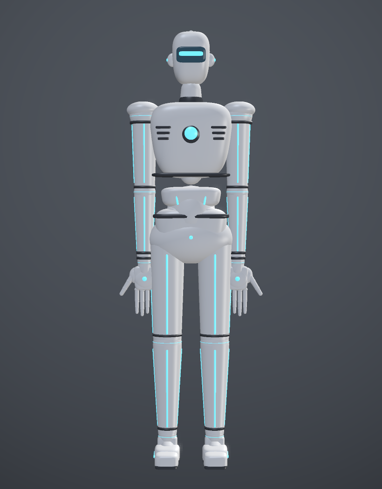
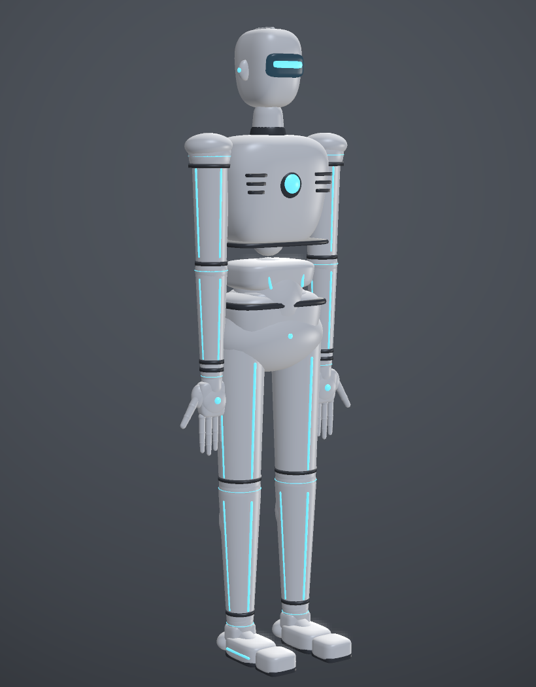
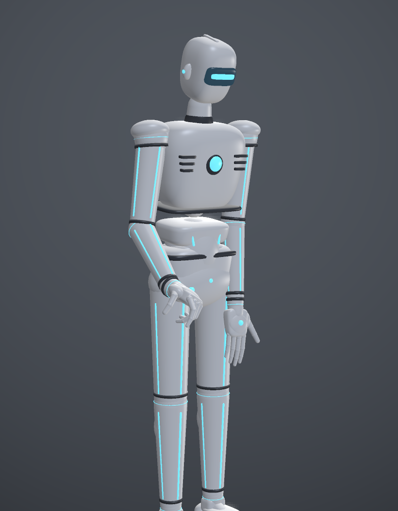

# humanoid_robot · 白色漆面科幻人形机器人

用于虚拟实验室（Virtual Lab Workshop）的**人形机器人硬件替身**：在你下单采购舵机、机械臂之前，
先在电脑里把这台"虚拟机器人"装进物理引擎，用真实关节链、真实质量惯量、真实手部自由度去验证
握笔书写、叠衣物、炒菜这类家务动作的可行性与可达性。

* 高度 **1.70 m**，总质量 **47.7 kg**，**74 个可控自由度**
* 全身**解析曲面**（球 / 胶囊 / 超椭球），无棱角、无低模感；白色高光漆面（roughness 0.26，metallic 0.06）
* **科幻化外装**：胸口能量核心、四肢青色导光条、关节发光环、石墨色护套与分模线、
  机甲肩盖、面罩里的发光眼线、头顶导流鳍、体侧散热口、石墨鞋底（详见第 3 节）
* 每只手 **19 个关节**（4 指 × 4 + 拇指 4 − 1），可以真正做出三指握笔、捏取、掌心下压等精细动作
* 直接提供 **GLB（整机）+ URDF + 逐连杆 OBJ**，三种格式同一套运动学



| 三视角 | 握笔 |
|---|---|
|  |  |

---

## 1. 文件清单

```
models/humanoid_robot/
├─ humanoid_robot.urdf        # 主运动学文件（引用 meshes/*.obj）
├─ humanoid_robot.glb         # 整机 GLB：76 node / 61 mesh / 4 material，约 4 MB
├─ poses.json                 # 5 组预设姿态（度）
├─ meshes/                    # 61 个逐连杆 OBJ + 共用 robot.mtl
├─ preview/                   # 软件渲染的校核图（正/侧/背/手/头/脚/姿态）
└─ build/                     # 参数化生成脚本（可改尺寸后一键重建）
   ├─ geom.py                 #   几何内核：矩阵、网格焊接、参数化曲面
   ├─ parts.py                #   零件库：每个 link 的曲面建模
   ├─ model.py                #   连杆表 + 关节表 + 正运动学 + 预设姿态
   ├─ export.py               #   GLB / OBJ / URDF 导出
   ├─ build_all.py            #   一键重建
   ├─ preview.py              #   纯标准库软件渲染器（出 PNG）
   └─ verify.py               #   资源自检（树结构 / 坐标往返 / 落地 / 姿态）
```

## 2. 四种材质与科幻外装

| 槽位 | 名称 | 用法 | 参数 |
|---|---|---|---|
| 0 | `robot_white` | 壳体主色 | 白漆 0.93，roughness 0.26，metallic 0.06 |
| 1 | `robot_visor` | 面罩玻璃 | 近黑 0.026，roughness 0.10，metallic 0.55，自发光微量 |
| 2 | `robot_glow` | 导光条 / 能量核心 / 眼线 | 青 0.18/0.88/1.00，自发光 `(0.20, 0.90, 1.00) × 3.0` |
| 3 | `robot_graphite` | 关节护套 / 散热口 / 鞋底 | 石墨 0.070，roughness 0.42，metallic 0.65 |

> 自发光强度用标准扩展 **`KHR_materials_emissive_strength`**（emissiveFactor 保持 ≤1，符合 glTF 规范）。
> three.js / Blender 会正确显示辉光；本工程的 `GlbLinkLoader` 只读 baseColorFactor，
> 所以发光件在那里会显示成明亮的青色实体条——同样能一眼看出是"灯带"。

科幻件清单（全部贴在曲面外 1.5~5 mm，不破坏光滑壳体；左右件由镜像生成）：

| 部位 | 件 |
|---|---|
| 头 | 面罩发光眼线、头顶导流鳍、太阳穴发光点、后脑三条散热槽 |
| 颈 | 石墨颈圈、颈环发光带 |
| 胸 | **能量核心**（石墨圆座 + 外凸发光透镜）、锁骨下双导光条、体侧六条散热口、背脊三条导光条、胸下分模线 |
| 腰 / 骨盆 | 双环发光带、石墨腰带、腰带圆形指示灯 |
| 肩 / 臂 | 肩球发光环、石墨肩护套、机甲肩盖、上臂双导光条、肘部发光环、前臂三导光条、腕部护套 |
| 手 | 腕部发光环、掌背圆形传感器 |
| 腿 / 脚 | 髋部发光环、大腿双导光条、膝部发光环、胫前与外侧导光条、踝环、石墨鞋底 + 鞋侧导光条 |

想回到"纯白漆"版本：把 `model.py` 里 `MATERIALS` 的第 2、3 项颜色改成白/浅灰并把自发光强度置 0，
重新 `python build_all.py` 即可；也可以只保留材质把 `parts.py` 里的配件 `m.add(...)` 注释掉。

## 3. 坐标与单位约定

| 项 | 约定 |
|---|---|
| 单位 | 米 / 千克 / 弧度（URDF 内） |
| 世界坐标 | **Z 向上**，**+X 机器人正前方**，**+Y 机器人左侧**（右手系） |
| 地面 | z = 0；静止站立时足底恰好 z = 0.0000 |
| 骨盆高度 | 0.90 m（`base_link` → `pelvis` 的固定关节） |
| 静止姿态 | 双臂自然下垂、掌心朝内、五指微屈 8° |
| 关节零位 | 所有 revolute 关节 = 0 时即为上述静止姿态 |

> `base_link` 是 z=0 处的空连杆，通过 **fixed** 关节接 `pelvis`。这样机器人默认被"焊"在地面，
> 做书写、炒菜这类固定工位动作时不会摔倒。要让它能走，把 `base_link_fixed` 改成浮动关节
> （MuJoCo 用 `<freejoint/>`，PyBullet 直接删掉该 joint 后 `loadURDF(..., useFixedBase=False)`）。

## 4. 自由度表（74 DOF）

体例：`{l|r}_` 前缀表示左右，角度为关节限位（度）。

### 躯干 / 颈（6）

| 关节 | 轴 | 限位 | 说明 |
|---|---|---|---|
| `spine_yaw` | Z | −55 ~ 55 | 腰部左右转 |
| `spine_pitch` | Y | −25 ~ 45 | 弯腰 / 后仰 |
| `spine_roll` | X | −28 ~ 28 | 侧倾 |
| `neck_yaw` | Z | −75 ~ 75 | 转头 |
| `neck_pitch` | Y | −45 ~ 45 | 点头（低头看纸面） |
| `head_roll` | X | −30 ~ 30 | 歪头 |

### 手臂（每侧 7，共 14）

| 关节 | 轴 | 限位 | 说明 |
|---|---|---|---|
| `shoulder_pitch` | −Y | −40 ~ 170 | 前屈 / 后伸 |
| `shoulder_roll` | X | −15 ~ 180 | 外展（抬臂） |
| `shoulder_yaw` | Z | −90 ~ 90 | 大臂内旋 / 外旋 |
| `elbow` | −Y | 0 ~ 150 | 屈肘 |
| `wrist_pitch` | −Y | −75 ~ 75 | 腕屈伸 |
| `wrist_dev` | X | −35 ~ 35 | 腕桡尺偏 |
| `wrist_roll` | Z | −110 ~ 110 | 前臂旋前旋后 |

### 手（每侧 19，共 38）

| 关节族 | 轴 | 限位 | 每侧数量 |
|---|---|---|---|
| `{f}_mcp_abd`（食指/中指/环指/小指张开） | X | −18 ~ 18 | 4 |
| `{f}_mcp`（掌指关节屈） | Y | −20 ~ 95 | 4 |
| `{f}_pip`（近指间关节屈） | Y | 0 ~ 110 | 4 |
| `{f}_dip`（远指间关节屈） | Y | 0 ~ 80 | 4 |
| `thumb_cmc_abd`（拇指对掌外展，基座带 31° 外倾） | X | −15 ~ 15 | 1 |
| `thumb_cmc_flex`（拇指腕掌屈） | Y | −10 ~ 60 | 1 |
| `thumb_mcp` | Y | −10 ~ 70 | 1 |
| `thumb_ip` | Y | −10 ~ 80 | 1 |

> 四指绕 **+Y 正方向屈曲即朝掌心**（掌心朝 −X），拇指同理，因此握笔时给出正角度就是"收拢"。
> 指节长度：食指 43/27/23 mm，中指 46/29/24 mm，环指 43/27/22 mm，小指 35/23/20 mm，拇指 40/32/26 mm。

### 腿（每侧 7，共 14）

| 关节 | 轴 | 限位 |
|---|---|---|
| `hip_yaw` | Z | −40 ~ 40 |
| `hip_roll` | X | −45 ~ 45 |
| `hip_pitch` | −Y | −30 ~ 120 |
| `knee` | Y | 0 ~ 145 |
| `ankle_pitch` | −Y | −45 ~ 40 |
| `ankle_roll` | X | −22 ~ 22 |
| `toe` | −Y | −20 ~ 60 |

### 质量分布（共 47.67 kg）

| 段 | kg | 段 | kg |
|---|---|---|---|
| 骨盆 | 6.50 | 大腿 / 小腿 / 脚 | 3.60 / 2.40 / 0.85 |
| 腰段 ×2 | 2.40 / 2.60 | 髋球 / 踝球 / 趾 | 0.50 / 0.25 / 0.18 |
| 胸腔 | 7.50 | 肩球 / 大臂 / 小臂 | 0.90 / 1.80 / 1.20 |
| 颈 / 头 | 0.60 / 2.20 | 腕 / 掌 / 单节指骨 | 0.25 / 0.42 / 0.014~0.028 |

惯量由各连杆网格包围盒按 0.9 系数折算，已写入 URDF `<inertial>`。

## 5. 接进 Virtual Lab Workshop

工程里的 `Model/GlbLinkLoader.vb` 就是为这种文件写的，**节点名等于 URDF link 名**，加载即可对上：

```vb
Dim robot = UrdfModel.Load("models/humanoid_robot/humanoid_robot.urdf")
Dim scene = GlbLinkLoader.Load("models/humanoid_robot/humanoid_robot.glb", robot)
' scene.Meshes("l_index_prox") → 该连杆的 LinkMesh（已在 link 局部系）
```

GLB 的三个关键约定（与 `GlbLinkLoader` 一致，已逐点校验）：

1. **Y-up**：URDF 的 `(x, y, z)` 在 GLB 里是 `(x, z, −y)`，加载器的 `YupToZup` 会还原。
2. **顶点在各自 link 的局部系里**：每个节点带自己的 mesh，`nodeToLink` 恰为单位矩阵，
   因此加载器算出来的三角形直接就是物理引擎 FK 需要的局部坐标。
3. **节点层次 = 关节树**：`base_link → pelvis → spine_lower → …`，标准渲染器（three.js / Blender）
   按节点变换拼装出来的姿态与 URDF 零位完全一致（偏差 < 1e-15 m）。

`verify.py` 会跑上面三条的逐顶点比对，改完模型后建议先 `python build/verify.py`。

## 6. 接进其它工具链

**PyBullet**

```python
import pybullet as p
body = p.loadURDF("models/humanoid_robot/humanoid_robot.urdf",
                  basePosition=[0, 0, 0], useFixedBase=True)
# 关节按 URDF 顺序索引；每个 link 都带 collision（圆柱/球/盒），可直接做接触仿真
```

**MuJoCo**：`mujoco` 自带 URDF 编译器可直接编译（全部关节是 revolute，无 mimic）。
需要自由基座时把 `base_link_fixed` 换成 `<freejoint/>`。

**Blender**：直接 `File > Import > glTF 2.0` 选 `humanoid_robot.glb`（61 个物体，按 link 命名），
或逐个导入 `meshes/*.obj`。

## 7. 预设姿态 poses.json

单位为**度**，未出现的关节按 0 处理。角度可直接喂给上面的关节名。

| 姿态 | 用途 | 右手落点 |
|---|---|---|
| `rest` | 站立中立位 | 垂于体侧 |
| `pen_grip` | 三指握笔（拇指+食指捏、中指托） | 身前 0.27 m、高 0.87 m |
| `pen_write` | 落笔关键帧，配合 `pen_grip` 循环成笔画 | 略低、腕下压 34° |
| `cook_stir` | 左手扶锅、右手持铲 | 身前 0.49 m、高 1.10 m |
| `fold_blanket` | 双臂前伸下压、掌心朝下 | 身前 0.50 m、高 0.99 m |

> `pen_grip` 的手腕在 z≈0.87 m，对应**站着在 0.85~0.95 m 的台面前书写**。
> 若你的虚拟台面是 0.75 m 的坐姿书桌，把 `r_shoulder_pitch` 从 12° 调到 4°、
> `r_elbow` 从 45° 调到 30° 即可（或直接上 IK）。

## 8. 重新生成 / 改尺寸

```bash
cd models/humanoid_robot/build
python build_all.py     # 重建 meshes/*.obj + glb + urdf + poses.json（约 1 s）
python verify.py        # 自检
python preview.py front three_quarter hand head   # 出预览图（纯标准库，约 8 s/张）
```

尺寸都写在 `parts.py`（零件曲面参数）和 `model.py`（关节原点、连杆长度）里，
例如把臂长从 0.30 改到 0.34，只需改 `_arm()` 里的 `xyz=(0,0,-0.300)` 与 `build_upper_arm()` 的胶囊终点。

## 9. 已知限制

* **没有纹理**，只有四种纯 PBR 材质（见第 2 节）。发光件靠 `emissiveFactor` + `KHR_materials_emissive_strength`
  实现，本身不带点光源；若要在物理引擎里让它们真的照亮环境，需要在仿真侧额外挂光源或用渲染后处理补 bloom。
* 碰撞体是**凸包近似**（圆柱 / 球 / 盒），适合接触级仿真；若要做抓握形变或精细摩擦，
  建议把 `meshes/*.obj` 转成凸分解（V-HACD）。
* 手指没有筋膜 / 肌腱耦合约束（URDF 不支持 underactuation），
  要做欠驱动手可在 MuJoCo 里加 `equality` 约束或用 `tendon`。
* 没有 ROS 特定内容（无 transmission、无 gazebo 插件、无 mesh scale 单位换算）。
